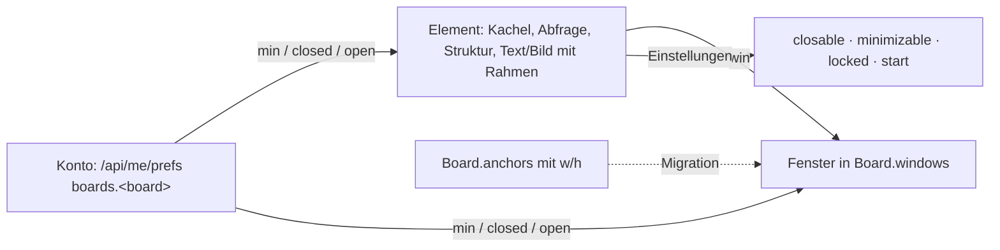

# Boards als Fenster-Desktop (T-435, REQ-458)

↑ [Roadmap](../Roadmap.md) · Karte T-435 · Anforderung REQ-458 · Stand 28.10.2026

Auftrag der Leitung (28.10.): Fenster statt Bereiche, Elemente dürfen sich
überlappen, Desktop-Verhalten (– minimiert auf die Titelleiste, X schliesst),
je Element einstellbar, ob es geschlossen werden darf.

**Ein Experiment** (Leitung 28.10.): gebaut auf `experiment/T-435-board-fenster`,
nie direkt gemerged. Übernimmt die Leitung es, wird es auf einem
`task/`-Zweig sauber umgesetzt; verwirft sie es, bekommt die Karte den
Grund, damit es nicht wieder auftaucht.

Zwei Teile: die **Bestandsaufnahme** (1) und das **Konzept** (2) mit einem
bedienbaren Mockup: [board-fenster-mockup.html](board-fenster-mockup.html),
veröffentlicht unter https://claude.ai/artifact/LYmRrVUcALgji9eCTtjLPT.

---

## 1. Bestandsaufnahme

### Wie ein Board heute gespeichert ist

| Was | Wo | Bemerkung |
|---|---|---|
| Kachel (Artikel auf dem Board) | Kante `placed` Board → Artikel, `props`: `x y w h z view locked hidden note` | REQ-157. `z` gibt es schon, `locked` auch. |
| Abfrage- und Struktur-Kachel | Kante `placed` des Boards **auf sich selbst** mit `props.query` bzw. `props.structure`, `title`, `display` | T-340, T-341 |
| Text, Bild, Zeichnung | `Board.shapes[]` (`kind`, `x y w h z rot`, `text`, `asset`, `points`, `hidden`) | T-339. Teilen sich mit den Kacheln einen `z`-Raum. |
| **Bereich** | `Board.anchors[]` mit `w`/`h` (`{id, name, x, y, w, h}`) | T-073, REQ-159. Ein Anker ohne Rechteck bleibt ein Sprungpunkt. |
| Zugehörigkeit Kachel ↔ Bereich | **nicht gespeichert** — die Mitte der Kachel liegt im Rechteck (`anchorAreaOf`) | Bewusst (T-073): eine Kante dafür liefe beim ersten Verschieben auseinander. |
| Eingeklappt | **nur im Browser** (`localStorage` `nw.board.<id>.collapsed`) | T-073: „am Board gespeichert klappte ein Spieler der Leitung die Conditions zu“. |
| Nur für die Leitung | `placed.props.hidden`, `shape.hidden` → `redactBoard` am Server | T-339 |
| Leinwand | `width`/`height` als Mindestgrösse, wächst mit dem Inhalt (`boardExtent`), Raster `snap` (Vorgabe 10 px), Hintergrund Bild/Farbe/Karte | T-339 |

Code: `packages/model/src/board.ts` (Lesen, Schreiben, Siebung),
`packages/registry/src/fieldgroups.ts` (`BoardInfo`),
`packages/registry/src/relations.ts` (`placed`),
`apps/web/src/app/boards/` (Seite: `board.ts` 1359 Zeilen, `board.html`,
`kachel.ts`, `abfrage.ts`, `struktur-kachel.ts`, `suche.ts`, Werkzeugleiste
in `werkzeuge.scss`).

### Wie es sich heute verhält

- **Überlappen geht schon technisch:** Kacheln und Formen liegen absolut, mit
  `z-index`. Was man zieht oder neu hinlegt, kommt nach oben
  (`obenauf() + 1`); die gewählte Kachel steht vorübergehend auf 10000.
  „Nach vorn / nach hinten“ gibt es nur für Formen. Ein **Klick allein** holt
  nichts nach vorn.
- **Einrasten** am Raster (`snapTo`) ist immer an; abschalten kann man es nur
  über das Feld `snap` im Formular.
- **Kachelkopf** (`.kkopf`) gibt es schon: Name, Art, Ansichtswahl, „GM“, „ד
  (vom Board nehmen — das *löscht* die Kante, ist also kein Schliessen).
- **Bereiche** (`section.bereich`) haben eine Kopfzeile mit ▾/▸ (einklappen),
  Umbenennen, Löschen; verschieben an der Kopfzeile (die Karten darin
  wandern mit), Grösse an der Ecke; Reiter oben zum Hinspringen; am Telefon
  mit Pointer-Events (T-146).
- **Rechte:** Wer das Board nicht schreibt (Spielende), sieht es nur;
  Einklappen geht trotzdem, weil es lokal ist.
- **Werkzeugleiste** links am Desktop, unten am Telefon (T-339, Muster aus
  T-325): Select, Article, Text, Image, Draw, Map, Background, Area.
- **Telefon:** dieselbe Leinwand, verkleinert und schwenkbar — kein eigenes
  Gerüst.

### Was es auf dev gibt (28.10., laufende Kampagne „Testkampagne“)

| Board | Kacheln | Bereiche | Formen | `z` |
|---|---|---|---|---|
| Demo board | 6 | 0 | 0 | 1 |
| T-340 · Query cards (test) | 3 | 0 | 0 | 1–3 |
| T-341 · Structure (test) | 2 | 0 | 0 | 1–2 |
| Test 0 | 2 | 0 | 0 | 0–1 |
| Testkampagne | 7 | **1** („Maps“, 1650×1100) | 0 | 1–11 |

Der Umzug der Bereiche betrifft auf dev also **einen** Bereich; in der
Produktion ist es vorher zu zählen (Migration zählt auf).

Nebenbefunde auf dev, nicht Teil dieser Karte:

- dev antwortete heute sehr langsam: `GET /api/list?type=Board` einmal 25 s,
  die Board-Seite blieb über Minuten bei „Loading … (data)“.
- Auf „Testkampagne“ zeigen vier Kacheln auf Artikel, die 404 geben („Not
  here — gone, or not yours to see.“).
- In der Liste der Testkampagne steht das „Demo board“ (Ebene Demo) — das
  ist T-413.

### Was schon da ist und wiederverwendet wird

- `nw-werkzeugleiste` / `nw-unterblatt` (`apps/web/src/app/muster/werkzeugleiste.ts`,
  REQ-345): schwebende Leiste und Blatt von unten am Telefon.
- Die Leiste des Ansichtsdesigners mit den Zonen Einfügen | Kontext |
  Allgemein (T-425, REQ-436, E-171 a; `ansichten/palette.ts`,
  `kern/ablage.ts`) — **gehört dem Chat T-425**; hier wird sie benutzt,
  nicht nachgebaut.
- Einstellungen je Konto: `GET/PUT /api/me/prefs/:key` (T-092), auf jedem
  Gerät desselben Kontos gleich. Grenze 8000 Zeichen je Schlüssel, und der
  Schlüssel erlaubt **kein `_`** (`^[a-z][a-zA-Z0-9.-]{0,63}$`) — Board-Ids
  wie `e_4ddcfaa46c84` passen so nicht hinein. Das ist für das Layout der
  Spielenden zu lösen (Konzept).
- Muster E-139 a (entschieden): ein Bereich hält ein Widget oder
  Ansichtselemente — gleich für Ansicht, Kachel, Board, Play-Schirm.

### Abhängigkeiten und Nachbarn

- E-140 (Viewpoints) ist **offen** — das Telefon-Verhalten hier sollte
  nicht auf einen Entscheid warten, sondern so gebaut werden, dass es
  später ein Viewpoint wird.
- T-024 (Spielleiter-Schirm „Fenster, Plätze“) und REQ-384
  (Widget-Katalog) wollen dasselbe Fenster — es soll darum ein Muster
  werden und nicht Teil der Board-Seite.
- T-413 (fremde Boards in der Liste) ist offen; nicht hier.

---

## 2. Konzept

Die ausführliche Fassung mit Mockup (Desktop und Telefon, Leitung und
Spielerin, derselbe Zustand je Person) steht in
[board-fenster-mockup.html](board-fenster-mockup.html). Kurz:

- **Titelleiste** mit – (auf die Titelleiste) und × (für mich schliessen) an
  Kacheln und Fenstern; Text und Bild auf Wunsch, Zeichnungen nie (E-196).
  × nimmt nichts vom Board.
- **Überlappen**, ein Klick holt nach vorn; die Leitung speichert `z` am
  Board, Spielende nur für sich bis zum Neuladen. Einrasten als Schalter je
  Person.
- **Einstellungen je Element** am Element (⚙): `closable`, `minimizable`,
  `locked` (gibt es), `start: 'min'`, `frame` für Text und Bild.
- **Stand je Person** (E-197): minimiert, geschlossen, entgegen der Vorgabe
  geöffnet — nur Abweichungen, im Konto unter `boards.<board>`; der
  Schlüssel muss dafür `_` erlauben.
- **Fenster als Behälter** in `Board.windows`, Zugehörigkeit gespeichert
  (`win`, E-195), Lage bleibt absolut.
- **Liste „Fenster ▾“** ersetzt die Reiter: Stand je Element, öffnet,
  stellt her, springt hin; „Mein Layout zurücksetzen“.
- **Telefon** (E-198): Stapel in Leserichtung, Dock der minimierten, Blatt
  von unten, Leinwand per Schalter.
- **Umzug:** Anker mit Rechteck → Fenster (gleiche Id, Name als Titel),
  Elemente mit der Mitte darin → `win`; Sprungpunkte bleiben; Eingeklapptes
  wird einmal zu „minimiert“.

**Schnitte** (je zuerst ein roter Test, E2E 1360/390 px): 1 Titelleiste und
persönlicher Stand · 2 Einstellungen je Element · 3 Fenster als Behälter
und Umzug · 4 Telefon · 5 Bericht für die Entscheidung Übernahme oder
Verwerfen.

**Offene Entscheide:** E-195 Zugehörigkeit (Empfehlung: gespeichert),
E-196 Titelleiste (Kacheln und Fenster, Text/Bild auf Wunsch), E-197
persönlich minimieren/schliessen, E-198 Telefon (Stapel, Dock, Blatt),
E-199 wie ausprobieren (Bilder und Video aus lokalem Lauf).

**Nicht hier:** die allgemeine Werkzeugleiste (T-425, REQ-436); das Board
tauscht nur „Area“ gegen „Window“. Rahmen und Stand werden ein Muster unter
`muster/`, damit Spielleiter-Schirm (T-024) und Widget-Katalog (REQ-384)
sie übernehmen.
