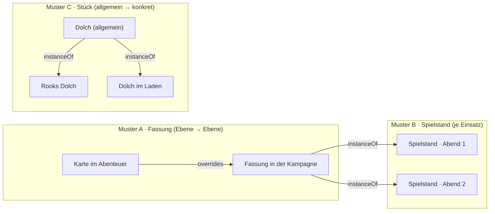

# Offene Konzepte vom 22.10.2026

**Vorschläge, nicht gebaut.** Sie antworten auf die Fragen der Leitung vom
22.10.2026:

- Instanzierung
- Karten für Spielende
- Settings
- Sorten
- Assets
- Verwaltung
- Freigaben an der Figur
- Zeigen
- laufende Kampagne

Die Entscheidungen tragen Nummern ab **E-136**, die Aufgaben ab **T-359**,
im Anschluss an das Projektbrett (zuletzt E-135, T-358). Die Liste fürs
Brett steht am Ende.

Die Entscheidungen E-1 bis E-3 aus
[Spieltisch-als-Boards.md](Spieltisch-als-Boards.md) waren falsch
nummeriert. Sie heissen jetzt **E-136**, **E-137** und **E-138** und sind
entschieden (unten).

---

## 1 · Instanzierung: drei Muster, drei Wörter (E-140)

### Was es heute gibt

| Mechanismus | Kante | Wofür heute | Wer es sieht |
|---|---|---|---|
| **Fassung** | `overrides` (in einer anderen Ebene) | ein fremder Artikel, angepasst in der eigenen Ebene (*Edit* an Fremdem, *Take* aus einem Abenteuer); ersetzt das Original im Stapel | wie jeder Artikel; das Original tritt zurück |
| **Ergänzung** | `overrides`, nur mit Zusätzen (E-125) | eine Fassung, die nur hinzufügt | wie Fassung |
| **Instanz** | `instanceOf` | Statblock einer Wache aus einer Vorlage; Gegenstand im Inventar (Stück, T-150); Fertigungsauftrag (Rezept); **Karte und Begegnung im Spiel** (T-289) | Instanzen stehen in keiner Liste; Karten im Spiel unter *Played* |
| **Variante** | `variantOf` | eine Spielart neben dem Original (Dolch +1 neben Dolch) | wie jeder Artikel |

Die Verwirrung kommt daher, dass **`instanceOf` drei verschiedene Dinge
trägt**. Es heisst für alle gleich, verhält sich aber verschieden:

- **Stück:** dieser eine Dolch im Rucksack von Rook.
- **Spielstand:** diese Karte heute Abend, mit Nebel und Tokens.
- **Auftrag:** dieses Schwert in Arbeit.

### Vorschlag

Technisch bleibt **eine** Kante `instanceOf`, denn alle drei lesen die
Vorlage darunter und speichern nur die Abweichung. **Sichtbar und in den
Regeln sind es drei Muster**, die nach der Art der Vorlage entschieden
werden, nicht je Artikel:

| Muster | Wort am Tisch | Wann | Spielende sehen | Beispiele |
|---|---|---|---|---|
| **A · Fassung** | *Adapted* | Inhalt aus einer anderen Ebene (Abenteuer, Regelwerk, anderes Setting) für diese Kampagne anpassen | das, was im Stapel gilt | Karte, Begegnung, NSC aus einem Abenteuer; Abstammung in ein anderes Setting |
| **B · Spielstand** | *In play* | etwas **wird gespielt**, und was dabei geschieht, soll die Vorbereitung nicht verändern | **nur den Spielstand**, nie die Vorlage | Karte, Begegnung; eine Zufallsbegegnung, die fünfmal vorkommt, hat fünf Spielstände |
| **C · Stück** | *Item* bzw. *copy* | es gibt das Allgemeine, und es gibt **dieses eine** mit Abweichungen | **das Allgemeine zum Nachschlagen** und das eigene Stück | Gegenstand im Inventar, Statblock einer Wache, Fertigungsauftrag |

Welches Muster gilt, sagt eine Angabe an der **Art**, wie `area`:
`InterfaceDef.instances: 'play' | 'piece'`, die `extends`-Kette hoch
geerbt.

- `Map` und `Encounter` sagen `play`. `Item`, `Statblock` und `Recipe`
  sagen `piece`.
- Ohne Angabe gibt es keine Instanzen. Kein Code fragt mehr nach
  `PLAY_INSTANCE_TYPES`; eine neue Art braucht dann keine Codeänderung.
- Eine Fassung ist kein Muster der Art: Sie geht immer, wo jemand Fremdes
  ändert.

**Was das klärt:**

- **Sichtbarkeit (E-136):** Eine Vorlage im Muster *Spielstand* sehen
  Spielende nie; eine im Muster *Stück* sehen sie wie jeden Artikel. Das
  ist dieselbe Regel für Karten und Dolche, nur aus verschiedenen Mustern.
- **NSC:** Ein NSC aus dem Abenteuer ist eine *Fassung* in der Kampagne.
  Dreissig Wachen sind *Stücke* eines Statblocks. Den NSC als Spielstand
  gibt es nicht; was ihm am Tisch geschieht (Trefferpunkte), steht am
  Kampfteilnehmer bzw. an `Vitals`.
- **Zufallsbegegnung:** eine Begegnung im Muster *Spielstand*. Jeder
  Einsatz (*Start encounter*) ist ein Spielstand, alle stehen unter
  *Played*.
- **Anzeige:** An jeder Vorlage steht, was an ihr hängt, zum Beispiel
  „Template · 2 in play · 1 adapted“. Am Spielstand steht „In play · from
  *Sewer Hideout*“. Heute sieht die Leitung nur „eine Karte“ und weiss
  nicht, dass es zwei gibt.

**Bewusst nicht:** drei verschiedene Kanten. Sie hiessen dreimal dasselbe
Lesen der Vorlage, und eine Korrektur am Auflösen müsste dreimal gemacht
werden.

---

## 2 · Spielende sehen nur Karten im Spiel (E-136, entschieden)

Entschieden von der Leitung am 22.10. Aus Abschnitt 1: Das gilt für Arten
im Muster **Spielstand**, nicht für Gegenstände.

- **Offen ist nur die Umgebung (E-139):** Rand der Karte darüber,
  Unterkarten-Rahmen, Hineinzoomen und Marker zwischen Kartenstufen lesen
  heute für Spielende die Vorlagen der umliegenden Karten. Vorschlag:
  - Eine Vorlage wird Spielenden **als Umgebung** eines freigegebenen
    Spielstands gezeichnet, also Bild, beschnitten unter dem Nebel des
    Spielstands, und Rahmen.
  - Sie wird **nie als Artikel** geöffnet: keine Liste, keine Suche, keine
    Artikelseite.
  - Hineinzoomen führt nur in freigegebene Spielstände (T-308).
- **Tests je Rolle:** Jede Prüfung zur Sichtbarkeit läuft als Leitung
  **und** als Spielerin, und das Ergebnis unterscheidet sich, wo es soll
  (Leitung 200, Spielerin 404). Die Testbestände legen Karten als
  Spielstand an (`kartenImSpiel`, steht auf `feature/nur-karten-im-spiel`).
  Ein Test, der nur eine Rolle prüft, gilt als halber Test.
- Die Kartenliste zeigt Spielenden die freigegebenen Spielstände an Stelle
  der Vorlage. Die Regel dahinter: Ein Spielstand steht dort, wo man seine
  Vorlage nicht sieht.

---

## 3 · Settings modular (E-141)

**Heute:** „Settings“ in der Ebenenwahl ist eine **Ebenengruppe nach
Kategorie** (wie „Core rules“, „Adventures“), die Bücher enthält. Sie
entstand beim Einlesen. Ein Setting als eigenes Ding gibt es nicht. Es gibt
aber `Layer.kind: world` (REQ-100) ohne Mitglieder.

**Vorschlag:** Ein Setting ist eine **Ebene der Art `setting`**. Sie
ersetzt `world` und behält dessen Sinn: von mehreren Kampagnen
aufschaltbar, gehört keiner.

- **Was zu einem Setting gehört, liegt in ihr**, egal ob Abstammung, Ort,
  Gegenstand, Monster oder Karte. Ein Buch, das zu einem Setting gehört
  (Quellenbuch), hängt mit `partOf` an der Setting-Ebene und wird mit ihr
  aufgeschaltet.
- **Modular:** Ein Setting ist eine Ebene wie jede andere. Wer ein Monster
  aus *Faerûn* in *Gedankenwelt* will, legt eine **Fassung** davon in
  *Gedankenwelt* (Muster A). Das Original bleibt in seinem Setting. Keine
  Kopie, kein „gehört zu zwei Settings“.
- **Kampagne:** Sie schaltet ein oder mehrere Settings auf, wie heute
  Bücher. Die Gruppe „Settings“ nach Kategorie bleibt eine Ordnung für
  Bücher und hat mit der Setting-Ebene nichts zu tun. Damit das nicht
  verwechselt wird, heisst die Kategorie künftig **„Setting books“**.
- **Erster Fall:** *Gedankenwelt* als Setting-Ebene anlegen und deine
  Karten mit *Move to layer* (Abschnitt 9) hineinschieben.

---

## 4 · Sorten als Listen (E-142)

**Heute:** `kind` ist ein freies Wort mit Vorschlägen aus dem, was an
anderen Artikeln steht (REQ-261). Eine Liste, die man vorher festlegt,
gibt es nicht.

**Vorschlag:** Eine Sorte zieht aus einer **Liste als Registerzeile**
(`REG.enums`, wie die Attribute), die das Feld mit `enumRef` nennt.

- **Listen erben:** Eine Liste darf eine andere erweitern
  (`extends`). „Place kinds“ trägt settlement, district, building; „Battle
  site kinds“ erweitert sie um cave, dungeon. So hat eine Artikelgruppe
  eine gemeinsame Grundliste, und ein Untertyp setzt seine eigene darauf.
- **Je Art, nicht je Artikel:** Welche Liste gilt, steht am Feld der Art
  und wird die `extends`-Kette hoch geerbt. Ein Untertyp darf eine andere
  Liste nennen. Eine Liste je einzelnem Artikel ist das, was
  „frei mit Vorschlägen“ schon kann.
- **Im Feld:**
  - Der Wähler zeigt die Liste, gruppiert nach ihrer Herkunft.
  - Unten steht **„+ Add to list“**: Wer das Register ändern darf, ergänzt
    die Liste; alle anderen tragen das Wort nur hier ein, es bleibt ein
    freier Wert und wird markiert.
  - Daneben **„Change list…“**: springt zum Feld der Art im Register,
    vorausgewählt die Art, von der man kommt. Dort wählt man eine andere
    oder neue Liste.
- **Was bleibt:** Freie Werte gehen weiter (die Prüfung hält nicht hart,
  wie bei Listen aus Artikeln, M6). Ein Wort ausserhalb der Liste
  zeigt der Prüfbericht der Werkbank an.

---

## 5 · Assets ohne Vorbereitungsstand (E-143)

**Nein, das ergibt wenig Sinn.** Ein Bild ist eine Datei, kein Text in
Arbeit. „Idea“ oder „Prepared“ an einem Asset heisst nur, dass es
Spielende nicht sehen. Das regelt heute schon die Karte (sie gibt ihr Bild
frei, PR #352) und sonst die Sichtbarkeit.

**Vorschlag:**

- `Asset` nimmt `Status` nicht mehr dazu, und ohne Karte zählt es als
  fertig (`isReady`).
- Eine Migration nimmt `Status` von den Assets und zählt, was sie
  anfasst. Zurückgehalten wird ein Bild künftig über `Visibility`, wenn
  überhaupt.
- Die Maske für Assets bietet den Stand nicht mehr an.

---

## 6 · Verwaltung (E-144)

Es gibt schon:

- die Kontoliste der Installation (W3);
- Mitglieder und Rollen je Kampagne;
- Einladungen;
- Ebenenrechte (`app_user_layer`).

Was fehlt, steht in einer Seite **Admin** (nur `is_admin`) mit drei
Reitern:

| Reiter | Inhalt |
|---|---|
| **Accounts** | anlegen, sperren und entsperren, Passwort zurücksetzen (Link), Verwaltung vergeben (REQ-229), Figuren je Konto |
| **Campaigns** | anlegen, archivieren, Leitung zuweisen; Mitglieder je Kampagne wie heute auf der Kampagnenseite, hier für alle Kampagnen auf einen Blick |
| **Content** | **welche Inhalte ein Konto überhaupt nutzen darf**: Ebenen und Ebenengruppen (Bücher, Settings) je Konto freigeben. Eine Leitung schaltet in ihrer Kampagne nur auf, was ihr freigegeben ist; Spielende sehen, was die Kampagne aufschaltet |

**E-144:** Freigaben je Konto als Zeile neben dem Konto
(`app_user_content`, wie `app_user_layer`), nie im Artikel. Vorgabe:
Alles ist freigegeben, solange keine Zeile etwas sagt. Wer einschränkt,
sagt es; so ist es heute auch bei der Sichtbarkeit.

---

## 7 · Freigaben an der Figur (E-137, entschieden)

Entschieden von der Leitung am 22.10.: **keine eigene Rolle
„Koordinator“.** Die Spielerin legt an ihrer Figur fest, wer sie in
welchem Mass sieht und bearbeitet. Die Kampagne setzt den Rahmen.

- **An der Figur**, von ihrer Spielerin gesetzt:

  | Mass | heisst |
  |---|---|
  | `view` | darf den ganzen Bogen sehen (auch, was die Gruppe sonst nicht sieht) |
  | `play` | darf am Tisch für sie handeln: Token ziehen, würfeln, Zugplan |
  | `edit` | darf den Bogen ändern (Vormundschaft) |

  Gespeichert als Zeilen neben dem Konto (`app_user_actor` mit `mode`):
  Ein Konto ist nie Inhalt eines Artikels (Zugang.md, REQ-199). Die
  Maske bietet Mitspielende nach Namen an.
- **Die Kampagne setzt den Rahmen** (`Campaign.characterSharing`):
  - welche Masse Spielende überhaupt vergeben dürfen;
  - ob die Leitung Vormundschaften selbst setzt (zum Beispiel für ein Kind
    am Tisch);
  - ob Tokens ohne Einschränkung gezogen werden dürfen (das gibt es schon:
    `tokenMove: all`).
- **Ein Koordinator** ist dann ein Konto, dem mehrere Figuren `play`
  geben. Er sieht, was diese Tokens sehen (Nebel je Figur und laufende
  Sicht gelten für alle Figuren, die er führt oder spielt).

---

## 8 · Zeigen als Popup (E-138, entschieden)

Entschieden von der Leitung am 22.10. Ergänzt [REQ-363](../../VTT/Stories/REQ-363.md):

- Was die Leitung zeigt, geht bei den Spielenden als **Popup** auf: der
  Inhalt in der Kurzansicht, Bild gross.
- Im Popup steht **„Keep on my board“**: Es legt den Inhalt auf das
  Spielerboard (eine `placed`-Kante). Mit *Close* ist es weg.
- Auf dem **Spielboard** steht dasselbe in der Kachel *Shown*, bis die
  Leitung etwas anderes zeigt. Im Protokoll steht jedes Zeigen.

---

## 9 · Kleineres

- **Move to layer** in der Werkbank: Die Auswahl in eine andere Ebene
  schieben. Das ist eine Massenänderung, die `inLayer` umhängt, mit Vorschau
  und Rückgängig wie jede. Ein Artikel in einer Ebene, die der Leitende
  nicht schreibt, wird übersprungen und genannt.
- **Immer eine laufende Kampagne:** Wer eine Rolle in einer Kampagne hat,
  hat immer eine laufende, und die Kopfleiste zeigt sie. Ohne Kampagne
  (Verwaltung, Vorbereitung ausserhalb) muss eine **Schreibebene** gewählt
  sein; ohne beides fragt *New article*, bevor es anlegt. *Take into play*
  und *Start encounter* legen den Spielstand in die Ebene der
  **Sitzung**, also ihrer Kampagne, nicht in die gewählte Schreibebene.
  Der Spielstand von „Sewer Hideout“ in „basil · Tests“ kam aus der
  Migration 106: Sie gab ihm die Ebene der Vorlage.
- **Ecken einer gespeicherten Form verschieben** (Link shape, Fläche eines
  Übergangs): Die Ecken lassen sich ziehen wie Wandpunkte, statt die Form
  neu zu zeichnen.

---

## Fürs Projektbrett

Entscheidungen:

| Nr. | Frage | Stand |
|---|---|---|
| E-136 | Spielende sehen nur Karten im Spiel (Muster *Spielstand*) | entschieden 22.10. |
| E-137 | Keine Rolle Koordinator; Freigaben an der Figur, Rahmen durch die Kampagne | entschieden 22.10. |
| E-138 | Zeigen als Popup, „Keep on my board“, dazu Kachel auf dem Spielboard | entschieden 22.10. |
| E-139 | Umgebung eines Spielstands für Spielende: Vorlage als Bild und Rahmen, nie als Artikel? | offen, Vorschlag §2 |
| E-140 | Instanzierung als drei Muster (Fassung, Spielstand, Stück), Angabe an der Art | offen, Vorschlag §1 |
| E-141 | Setting als Ebenenart `setting` (ersetzt `world`), modular über Fassungen | offen, Vorschlag §3 |
| E-142 | Sorten als Listen-Registerzeilen mit `extends`, erweiterbar im Feld | offen, Vorschlag §4 |
| E-143 | Assets ohne Vorbereitungsstand | offen, Vorschlag §5 |
| E-144 | Inhalte je Konto freigeben (`app_user_content`), Vorgabe alles | offen, Vorschlag §6 |

Aufgaben:

| Nr. | Aufgabe | Story |
|---|---|---|
| T-359 | Spielende sehen nur Spielstände; Tests je Rolle; Umgebung nach E-139 | [REQ-372](../../VTT/Stories/REQ-372.md) |
| T-360 | *Move to layer* in der Werkbank | [REQ-365](../../VTT/Stories/REQ-365.md) |
| T-361 | Setting-Ebene, *Gedankenwelt* anlegen | [REQ-100](../../VTT/Stories/REQ-100.md) |
| T-362 | Sorten als Listen | [REQ-366](../../VTT/Stories/REQ-366.md) |
| T-363 | Seite Admin: Konten, Kampagnen, Inhalte | [REQ-367](../../VTT/Stories/REQ-367.md), [REQ-229](../../VTT/Stories/REQ-229.md) |
| T-364 | Immer eine laufende Kampagne oder Schreibebene; Spielstand in die Ebene der Sitzung | [REQ-368](../../VTT/Stories/REQ-368.md) |
| T-365 | Freigaben an der Figur | [REQ-369](../../VTT/Stories/REQ-369.md) |
| T-366 | Assets ohne `Status`, mit Migration | [REQ-370](../../VTT/Stories/REQ-370.md) |
| T-367 | Muster an der Art, Anzeige „Template · in play · adapted“ | [REQ-371](../../VTT/Stories/REQ-371.md) |
| T-368 | Ecken gespeicherter Formen verschieben — **zusammengeführt in T-370** | REQ-142 |
| T-369 | Zeigen als Popup mit „Keep on my board“ | [REQ-363](../../VTT/Stories/REQ-363.md) |
