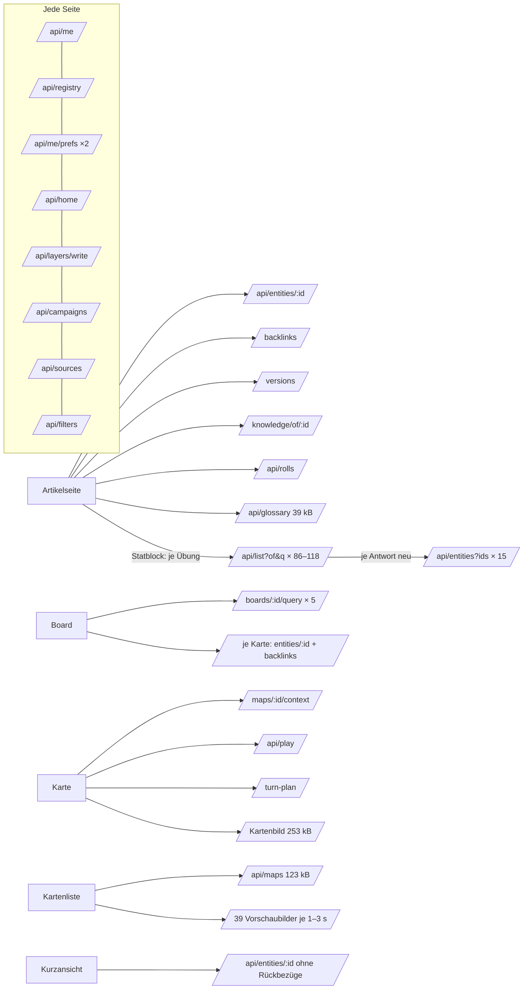

# Laden der Artikel — Analyse (T-398)

Aufgabe [T-398](https://claude.ai/artifact/QqPGBdyiwz69f9E3NxQb3D) setzt
REQ-397 um (Bezug REQ-246). Gemessen am 28.10.2026, 11:45–12:30 UTC, auf
dev (`dev.ttrpg.fuchsbau.io`, Stand preprod `407935f5`). Gemessen wurde nur
lesend, als Dienstkonto „claude“ (Leitung der Testkampagne) und in der Sicht
von „test-basil“ (Spieler, `x-view-as`). Werkzeug:
[`scripts/laden-messen.mjs`](../../scripts/laden-messen.mjs), frischer
Browser je Seite (kalter Cache), Telefon 390 px und Desktop 1360 px.

**Bestand auf dev:** 211 249 Zeilen in `entity` (die rund 56 000 Artikel
und ihre Teile, z. B. Buchabschnitte; so meldet es der Server beim Start).

## Kurz: stimmt der Verdacht?

**Im Browser nicht, am Server ja.** Und auf der Artikelseite wirkt es so,
als würde alles geladen.

1. **Der Browser lädt keine Liste aller Artikel.** Das ist seit W7
   (13.10.) so (`kern/bestand.ts`): das Register kommt allein (31 kB), ein
   Artikel kommt beim Öffnen, Listen fragen seitenweise (`/api/list`,
   50 Zeilen ≈ 47 kB).
2. **Die Artikelseite einer Figur macht aber 115–150 API-Abrufe** und wird
   in 60 s nicht fertig. 86–118 davon sind `/api/list?of&q`: **je
   Übungsname eine eigene Suche** (`artikel/statblock.ts:122`), dazu 15×
   `/api/entities?ids`, die dieselben Artikel schubweise nachholen. Der
   Server arbeitet sie nacheinander ab, also stauen sie sich bis 33 s.
   Für Basil sieht das aus wie „lädt alles“.
3. **Der Server arbeitet bei jeder Anfrage auf dem ganzen Bestand.** Alle
   211 249 Zeilen liegen im Speicher. Jede Anfrage prüft mit `count(*)`
   und `max(updated_at)` über die ganze Tabelle, ob sich etwas geändert
   hat, und baut sich oft eine eigene `Map` daraus. Darum kostet schon
   `/api/me` 0,65–1,5 s. **Nach jeder Änderung** wird der ganze Bestand neu
   gelesen und der Listenindex neu gebaut: der erste Listenabruf danach
   dauerte **30 s und endete mit 502** (Leitung) bzw. **23,6 s**
   (Spieler). Während einer Sitzung ändert jeder Treffer etwas.

## Messwerte

„Steht“ heisst: 500 ms ohne Abruf, ohne den Live-Kanal. Zeiten gelten bis
dahin; mit „> 60 s“ ist die Messung abgebrochen.

### Seiten (kalter Browser, Leitung)

| Seite | 390 px | 1360 px | Abrufe (API) | übertragen (JS / API) | doppelt |
|---|---:|---:|---:|---|---|
| Start (Kampagnenboard) | 39,1 s¹ | 9,0 s | 55 (16) | 766 kB (500 / 183) | `/api/home`×2, `/api/me/prefs`×2 |
| Kompendium | 9,6 s | 8,2 s | 54 (15) | 766 kB (500 / 182) | `/api/me/prefs`×2 |
| Bereich *world* | 7,5 s | 7,4 s | 52 (13) | 702 kB (500 / 119) | `/api/me/prefs`×2 |
| **Artikel (Figur Brakka)** | **> 60 s** | **> 60 s** | **203 (150)** | 1147 kB (720 / 246) | **`/api/list?of&q`×118**, `/api/entities?ids`×15, `/api/entities/:id`×2 |
| Kartenliste `/maps` | 27,5 s | 29,9 s | 84 (48) | 1842 kB (407 / 1351) | 39 Vorschaubilder |
| Karte (`/play?map=`) | 12,9 s | 13,3 s | 49 (12) | 881 kB (498 / 299) | — |
| Board (Kampagne) | 17,9 s | 18,6 s | 63 (19) | 761 kB (574 / 60) | `/api/boards/:id/query/:id`×5, `/api/entities/:id`×2 |

¹ Erster Abruf nach einem Neustart des Servers; die zweite Runde lag bei
9 s.

### Als Spieler (test-basil, 390 px)

| Seite | Zeit | Abrufe (API) | Auffällig |
|---|---:|---:|---|
| Start (Kampagnenboard) | 29,7 s | 77 (31) | `/api/entities/:id`×9 und `…/backlinks`×6 einzeln (N+1), zwei 404 |
| Kompendium | 9,7 s | 55 (14) | wie Leitung |
| Artikel (Figur Test Cleric) | > 60 s | 168 (115) | `/api/list?of&q`×86 |

### Einzelne Abrufe (curl, warm)

| Abruf | Leitung | Spieler | Grösse |
|---|---:|---:|---:|
| `/api/me` | 0,74 s | 0,10 s | 2,7 kB |
| `/api/registry` | 0,3 s | — | 31 kB (gzip) |
| `/api/list?limit=50` (Index warm) | 0,51 s | 0,50 s | 47 kB |
| `/api/list?limit=50` (**erster nach einer Änderung**) | **30 s → 502** | **23,6 s** | — |
| `/api/entities/:id` (Figur, 2,8 kB) | 1,3–2,5 s, in der Spitze 8–30 s | 1,3–2,5 s | 2,8 kB |
| `/api/maps` | 2,5 s | 2,5 s | 123 kB / 1,6 kB |
| Vorschaubild `/api/assets/:id?size` | 0,8–3,3 s Server je Bild | | 14–39 kB |

Gegen 11:47 UTC startete der Server neu („Server is starting“,
`articles: 211249`). Ein Deploy war da nicht im Gang (der letzte Merge nach
preprod war um 10:39 UTC). **Die Ursache ist offen**; die Logs sollten auf
Speichermangel geprüft werden.

### Startpaket

`main` und die Chunks für den Start: **≈ 500 kB gzip** (der grösste Chunk
hat 760 kB roh und 209 kB gzip). Die Artikelseite lädt weitere 220 kB nach.
Die Dateinamen tragen einen Hash, kommen aber mit `Cache-Control: public,
max-age=0`. Jeder Besuch fragt also jede Datei neu an (ETag → 304), statt
sie ein Jahr zu behalten. Budget in `angular.json`: Warnung 500 kB, Fehler
1,25 MB (T-217, T-348).

## Ladepfade je Seite



- **Jede Seite** holt zuerst 8 Grundabrufe (`me`, `registry`, `me/prefs`
  doppelt, `home`, `layers/write`, `campaigns`, `sources`, `filters`).
  Jeder davon, der den Bestand anfasst, kostet am Server 0,5–1,5 s.
- **Kompendium und Bereiche:** `/api/list` seitenweise (50 Zeilen, 11 kB
  bzw. 6 kB) und die Bilder der Kopfleiste und Zeilen. Das ist in Ordnung;
  langsam macht es die Grundlast.
- **Artikelseite:** der Artikel samt Rückbezügen, Fassungen, Wissen, Würfen
  und Glossar. Dazu kommt die N+1-Flut aus dem Statblock (oben). Dasselbe
  Muster hat `artikel/mehrfach.ts:333` (eine Suche je Gruppe).
- **Kurzansicht:** ein `/api/entities/:id` ohne Rückbezüge (`vorschau.ts`).
  Das ist richtig gebaut, kostet aber 1,3–2,5 s am Server. Per Hover liess
  sie sich im Script nicht auslösen; gemessen ist der Abruf selbst.
- **Board:** fünf Abfragekacheln je für sich, und **jede Karte holt ihren
  Artikel samt Rückbezügen einzeln** (`boards/board.ts:232`, `oeffnen(k.to,
  false, true)`), obwohl eine Kachel keine Rückbezüge zeigt. Für Spieler
  kommen zwei 404 dazu (Ziele, die sie nicht sehen).
- **Karte:** Kontext, Spielstand, Zugplan, Kartenbild (253 kB,
  `no-cache`). Zahlenmässig in Ordnung; langsam macht es die Grundlast.
- **Kartenliste:** 39 Vorschaubilder gleichzeitig, je 1–3 s Server, und sie
  stauen sich bis 22 s. Die Bilder sind `immutable`, beim zweiten Besuch
  also schnell; der erste Besuch nach jeder neuen Karte bleibt langsam.

## Die 5 grössten Hebel

| # | Hebel | Wo | Aufwand | Wirkung |
|---|---|---|---|---|
| 1 | **N+1 abstellen** | web (+ server) | S–M, 2 PRs | Artikelseite einer Figur: von > 60 s und 150 Abrufen auf ≈ 12 Abrufe und 2–3 s. Entlastet den Server auch für alle anderen. |
| 2 | **Grundlast je Abruf senken** | server, db | S–M, 1–2 PRs | jeder Abruf, der den Bestand anfasst: von 0,5–1,5 s auf < 0,15 s. Wirkt auf jede Seite, Kurzansicht 1,3–2,5 s → < 0,3 s. |
| 3 | **Nach einer Änderung nicht alles neu** | server, model | L, 2–3 PRs | kein 23–30 s / 502 nach einem Schreiben; Listen bleiben am Tisch unter 1 s. Schliesst T-006 ab. |
| 4 | **Vorschaubilder vorrechnen, Bilder später laden** | server, web | M | Kartenliste und Galerie: von 28 s auf < 3 s; das Kartenbild wird gecacht. |
| 5 | **Startpaket und statische Dateien** | web, deploy | S (Cache) + M (T-217, T-348) | Rückkehr ohne 50 Rückfragen; Startpaket < 1 MB roh. Telefon −0,5–1 s. |

### 1 · N+1 abstellen (zuerst)

- **Statblock-Übungen in einem Abruf:** statt je Name `list({of, q})` eine
  Frage mit allen Namen. Entweder `GET /api/list?of=…&names=a|b|c` (exakte
  Namen, gesiebt wie die Liste) oder, besser, der Server bringt die Ziele in
  `refs` des Artikels gleich mit, wie er es für Kanten und `[[Verweise]]`
  schon tut. Das `holen`-Effekt, das jetzt 15× neu feuert, entfällt damit.
- **Board:** die Kartenartikel in **einem** `/api/entities?ids=` und ohne
  Rückbezüge (`rueck: false`). Die fünf Abfragekacheln in einem Abruf oder
  der Reihe nach, sobald sie sichtbar sind.
- **Doppelte Grundabrufe:** `/api/me/prefs` ×2 und `/api/home` ×2 je
  Seite. Ein laufendes Promise teilen, wie es `Bestand.load` schon tut.
- **Test zuerst:** ein Komponententest (Statblock mit 40 Übungen → genau
  ein Listenabruf) und eine E2E-Messung (Artikelseite ≤ 15 API-Abrufe).

### 2 · Grundlast je Abruf senken

- **Der Stempel ist teuer und wird mehrfach gefragt.** `PgRepository.stempel`
  läuft in `roh()` *und* in `listEntities()`, in vielen Routen mehrmals,
  und jedes Mal als `count(*)` plus `max(updated_at)` ohne Index über
  211 249 Zeilen. Vorschlag: eine Zeile `bestand_stand (n bigint)`, die ein
  Trigger bei jedem Schreiben und Löschen hochzählt. Das ist eine
  Indexabfrage statt zwei Tabellenscans und bleibt richtig, wenn die
  Einfuhr als eigener Prozess schreibt. Dazu den Stempel **je Anfrage
  einmal** fragen.
- **Keine Kopie und keine eigene `Map` je Route:** `listEntities()` gibt
  `[...liste]` zurück (211 249 Einträge kopiert), und rund 30 Stellen im Server bauen
  daraus `new Map(...)`. `roh().map` liegt schon bereit; nur lesend
  weitergeben.
- **`Server-Timing` aufteilen** (`db`, `stand`, `sieb`, `antwort`), damit
  das Messscript zeigt, wo die Zeit bleibt (Bezug T-007).

### 3 · Nach einer Änderung nicht alles neu

Heute heisst ein geänderter HP-Wert: drei Abfragen über den ganzen Bestand,
211 249 Artikel neu zusammensetzen, Stapel und Listenindex neu rechnen, und
zwar je Betrachter. Vorschlag in zwei Schritten:

1. **Im Prozess nachführen:** schreibt der Server selbst (`putEntity`,
   `deleteEntity`), ersetzt er die eine Zeile im gehaltenen Bestand und
   setzt den Stempel nach. Neu gelesen wird nur, wenn ein fremder Prozess
   geschrieben hat (Einfuhr).
2. **Den Listenindex ändern statt neu bauen:** eine geänderte Zeile wird
   neu gesiebt und eingesetzt. Das Wissen der Spielenden (T-006) wird je
   Stempel einmal als Index `knownBy → Felder` gerechnet, nicht je Artikel
   über den ganzen Bestand.

**Zur Entscheidung (Leitung):** eine Brücke bis Schritt 2 wäre, für
höchstens 2–3 s den alten Index zu liefern, während der neue im
Hintergrund entsteht. Das widerspricht dem Satz in `kern/bestand.ts`
(„kein Zwischenspeicher mit Verfallsdatum … ehrlicher als eine Heuristik,
die manchmal Altes zeigt“). Darum nur mit Freigabe. Ohne diese Brücke
bleibt Schritt 2 der Weg, er braucht nur länger.

### 4 · Vorschaubilder

- Die Vorschaubilder einmal beim Hochladen rechnen und ablegen, oder beim
  ersten Abruf auf der Platte. Danach kostet ein Abruf eine Datei und nicht
  1–3 s.
- In Listen `loading="lazy"` und nur die sichtbaren Zeilen laden, mit
  höchstens 6 gleichzeitig.
- Das Kartenbild (253 kB) kommt mit `no-cache`; mit Version in der Adresse
  wie bei den Vorschaubildern geht `immutable`.

### 5 · Startpaket und statische Dateien

- Gehashte Dateien (`chunk-*.js`, `main-*.js`, `styles-*.css`) mit
  `Cache-Control: public, max-age=31536000, immutable`, `index.html` mit
  `no-cache`. Das sind wenige Zeilen in `app.ts` (`fastifyStatic`,
  `setHeaders`).
- T-217 und T-348: Hilfe, What's new und Handbuch erst bei Bedarf laden,
  Barrel-Importe aus `@nw/model` gezielt machen, Budget wieder auf 1 MB.

### Ausserdem (REQ-397, Abnahme 2)

**Fehler sichtbar und wiederholt:** ein 502 nach 30 s (Caddy) zeigt heute
eine leere Liste. Vorschlag: bei 502/503 und Abbruch einmal nach 1–2 s
wiederholen und dann melden („Server antwortet nicht — erneut versuchen“).
Der Server meldet `503 starting` schon; die Oberfläche soll es auch für
Listen anzeigen. Das fällt mit Hebel 3 zum grössten Teil weg, gehört aber
trotzdem dazu.

## Zielwerte (Vorschlag)

Gemessen mit `scripts/laden-messen.mjs` auf dev, mit dem ganzen Bestand,
nach einer Aufwärmrunde, als p50 aus 3 Runden. Grundlage ist REQ-246:
Seitenwechsel < 1 s.

| Was | heute | Ziel |
|---|---:|---:|
| Artikelseite (Figur), Desktop / Telefon | > 60 s | ≤ 2 s / ≤ 2,5 s |
| API-Abrufe der Artikelseite | 115–150 | ≤ 15, keiner doppelt |
| Kompendium / Bereich, erste Zeilen | 7–10 s | ≤ 1,5 s (Seitenwechsel im Browser ≤ 1 s) |
| Kurzansicht (`/api/entities/:id`, Server) | 1,3–2,5 s | ≤ 0,3 s (p95) |
| Grundabruf `/api/me`, `/api/home` (Server) | 0,7–1,5 s | ≤ 0,1 s |
| Erster Listenabruf nach einer Änderung | 23–30 s, 502 | ≤ 2 s, nie 502 |
| Board / Karte | 18 s / 13 s | ≤ 3 s |
| Kartenliste, erste Bildschirmfüllung | 28 s | ≤ 3 s |
| Startpaket (Erstbesuch) | ≈ 500 kB gzip | ≤ 400 kB gzip, < 1 MB roh |
| Wiederkehr: Rückfragen für statische Dateien | ≈ 40 | 0 (ausser `index.html`) |

## Vorgeschlagene Reihenfolge

1. Hebel 1 (N+1) und das Messscript, mit einem Test für die Abrufzahl.
2. Hebel 2 (Stempel, Kopien, Server-Timing aufgeteilt).
3. Hebel 5, Teil Cache (klein und sofort spürbar).
4. Hebel 3, Schritt 1, danach Schritt 2 zusammen mit T-006.
5. Hebel 4 und Wiederholen mit Meldung.

Jede Stufe kommt als eigener PR nach preprod, mit einer Messung vorher und
nachher in der Beschreibung.

## Messen

```bash
node scripts/laden-messen.mjs --base https://dev.ttrpg.fuchsbau.io \
  --artikel <figur-id> --karte <karten-id> --board <board-id> \
  [--als <konto-id>] [--nur Artikel,Board] [--breiten 390,1360] [--json m.json]
```

Das Script hält nur Wege (Ids als `:id`, Abfragen nur mit ihren
Schlüsseln), Status, Bytes, Zeiten und Cache-Kopf fest, keine Inhalte. Die
Rohdaten dieses Berichts liegen nicht im Repo.
