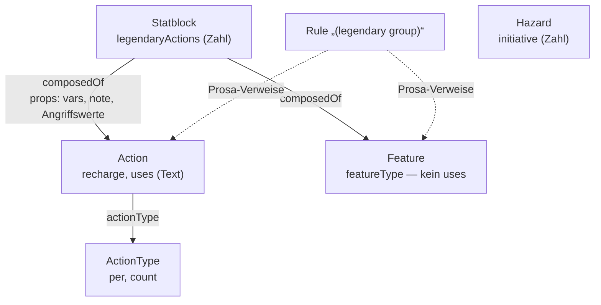

# Legendary, Lair und Mythic: was auf dev steht (T-380)

Bestandsaufnahme für die Rundenzähler und Lair-Zeilen im Tracker
(REQ-362, REQ-364, T-375). **Nur gelesen**: ein `GET /api/entities` auf
dev am 28.10.2026 um 17:05Z als Dienstkonto `claude` (132 233 Artikel
nach dem Sieb). Hier stehen nur Zahlen, Feld- und Typnamen, keine Texte
aus 5e.tools.

Die Entscheide E-155, E-158 und E-185 sind offen. Dieser Bericht
entscheidet keinen davon. Er sagt nur, welche Daten eine Vorbefüllung
vorfände.

## Kurz

| Frage | Antwort |
|---|---|
| Legendary Actions je Runde am Statblock? | **ja**, `Statblock.legendaryActions` an 401 von 3 712 Statblöcken (391 × 3, 10 × 2) |
| Die Aktionen selbst? | **ja**, 843 `Action`-Artikel mit Aktionsart „Legendary Action", über `composedOf`, an genau denselben 401 Statblöcken |
| Kosten („Costs 2 Actions")? | **nur im Namen**: 329 der 843 (224 × 2, 105 × 3), kein Feld, nichts an der Kante |
| Mehr Legendary Actions im Lair (`legendaryActionsLair`)? | **fehlt**: der Importer zählt das Feld als gelesen, schreibt es aber nirgends hin |
| Lair Actions? | **ja, gebündelt**: 132 `Action`-Artikel „Lair Actions (…)" aus 190 Legendary Groups, verknüpft an 151 Statblöcken; die Optionen stehen als Text in **einem** Artikel |
| Initiative 20 für Lair? | **nur im Text** (130 von 132), kein Feld |
| Mythic? | 22 `Action`-Artikel „Mythic Action" an 17 Statblöcken; der Mythic Trait ist ein `Feature` ohne Kennzeichen, nur bei 3 steht er im Namen |
| Legendary Resistance? | 151 `Feature`-Artikel (an 406 Statblöcken), die Anzahl je Tag **nur im Namen** |
| Hazards mit Initiative? | `Hazard.initiative` an 4 von 107 |
| Recharge? | `Action.recharge` an 771 Aktionen (Text, z. B. „5–6"), `Action.uses` an 303 |

## Was im Register steht

- `Statblock.legendaryActions` (`packages/registry/src/fieldgroups.ts`):
  die Anzahl je Runde. Ein zweites Feld für den Lair-Fall gibt es nicht.
- `ActionTypeInfo` (Karte `ActionType`) hat `per` (`turn`/`round`) und
  `count`. Auf dev: Action, Bonus Action und Free Object Interaction 1 je
  Zug, Reaction und Lair Action 1 je Runde. Legendary und Mythic Action
  haben nichts, weil die Anzahl am Statblock steht.
- `ActionInfo` (Feldgruppe von `Action`) hat `recharge` und `uses` als
  Text. Ein Feld für Kosten fehlt.
- `FeatureInfo` hat **kein** `uses`. Legendary Resistance („3/Day") und
  der Mythic Trait („Recharges after a Short or Long Rest") tragen ihre
  Grenze nur im Namen.
- Die Kante `composedOf` trägt je Statblock `vars` (663 der Kanten zu
  Legendary Actions), selten Angriffswerte. Eine Kosten-Angabe trägt sie
  nicht.
- Was die Leseansicht daraus macht, steht in `packages/model/src/book.ts`:
  sie erzeugt den Einleitungssatz („can take N legendary actions") aus
  `legendaryActions` und gruppiert nach Aktionsart. Die Aktionsart
  „Legendary Action" zählt im Zugplan als Aktion (`actions.ts`).

## Was der Import liefert

Einlesen: `packages/import-5etools/src/arten/monster.ts`.

| 5e.tools-Feld | Wohin | Stand auf dev |
|---|---|---|
| `legendary` | je Eintrag eine `Action` (Legendary Action), `composedOf` | 843 Artikel, 82 davon von mehreren Statblöcken geteilt |
| `legendaryActions` | `Statblock.legendaryActions`, sonst 3, wenn `legendary` da ist | 401 |
| `legendaryActionsLair` | **nirgends**: steht in `GENUTZT_MONSTER`, wird nicht geschrieben | 0 |
| `legendaryHeader`, `mythicHeader` | als Prosa an den Statblock | Einleitung bei 4 der 401 in der Prosa, bei 3 der 17 mythischen |
| `mythic` | je Eintrag eine `Action` (Mythic Action) | 22 an 17 Statblöcken (alle 17 haben auch `legendaryActions`) |
| `legendaryGroup` → `lairActions` | **eine** `Action` „Lair Actions (…)" je Gruppe, Optionen als Text | 132, davon 26 an keinem Statblock |
| `legendaryGroup` → `regionalEffects` | ein `Feature` (`featureType: regional`) | 173 Artikel, an 218 Statblöcken |
| `legendaryGroup` → `mythicEncounter` | ein `Feature` | 3 |
| Legendary Resistance (unter `trait`) | ein `Feature`, Grenze im Namen | 151 Artikel |

Die 190 Legendary Groups sind `Rule`-Artikel mit der Marke
`legendary group`. 58 davon haben keine Lair Actions (nur regionale
Effekte o. Ä.). 32 Statblöcke tragen Lair Actions, aber keine Legendary
Actions (z. B. jüngere Altersstufen, die sich die Gruppe teilen).

Die 401 Statblöcke kommen aus 47 Veröffentlichungen. Am meisten:
Monster Manual (2025) 46, Monster Manual 38, Fizban's 36, Monsters of
the Multiverse 31. 140 davon gehören einer benannten Kreatur
(`belongsTo`, T-169), 126 sind Spielart eines anderen (`variantOf`).

## Was fehlt

Nach Gewicht für T-375/T-376:

1. **Kosten einer Legendary Action** stehen nur im Namen (329 von 843).
   Für „Knopf je Kosten" (E-155 a) bräuchte `Action` ein Feld `cost`,
   gefüllt beim Import und auf dev nachgetragen. Wie der Zähler Kosten
   kennt, entscheidet E-155. Darum steht dafür nur eine Karte, die auf
   E-155 wartet.
2. **`legendaryActionsLair` fehlt.** Neuere Statblöcke (Monster Manual
   2025: „3 (4 in Lair)") verlieren die Lair-Zahl beim Import. Das ist
   ein Importfehler, unabhängig von den Entscheiden: ein Feld
   `Statblock.legendaryActionsLair` und der Importer schreibt es.
3. **Lair Actions sind ein Artikel je Gruppe, nicht je Option.** Für eine
   Lair-Zeile mit Freitext (E-154) reicht das; für Zähler je Option nicht.
   Initiative 20 steht nur im Text. Der Tracker kann die Regel-Vorgabe 20
   nehmen (T-375); ein Feld braucht es erst bei Ausnahmen.
4. **32 Statblöcke erwähnen Lair Actions in ihrer Prosa, ohne einen
   verknüpften Artikel** (MM 10, FTD 22). Vermutlich fehlt die Gruppe beim
   Nachschlagen (`insLeere('legroup', …)`), oder die Lair Actions stehen
   im Statblock selbst. Klärt eine Importer-Prüfung.
5. **26 Lair-Action-Artikel hängen an keinem Statblock**: Gruppen, deren
   Statblöcke nicht hereinkamen oder auf eine andere Fassung zeigen.
6. **Mythic Trait und Legendary Resistance haben keine Anwendungsgrenze
   als Feld.** Ob sie Zähler werden, entscheidet E-185 (Nr. 3 und 4).
   Erst danach: `Feature.uses` und der Mythic Trait als erkennbares
   Merkmal (heute nur 3 von 17 im Namen).
7. **`Hazard.initiative`** ist bei 4 von 107 gesetzt. Für komplexe Fallen
   (E-185 Nr. 8) muss man es erst aus dem Text holen.

## Karten

Die Lücken stehen auf dem Brett (`bretter/atlas-mentis/tasks`):

- T-437: `legendaryActionsLair` einlesen (Lücke 2), bereit.
- T-438: Lair Actions ohne Verknüpfung und verwaiste Lair-Artikel
  prüfen (Lücken 4, 5), bereit.
- T-439: Kosten einer Legendary Action als Feld (Lücke 1), wartet auf
  E-155.
- T-440: Anwendungsgrenzen für Legendary Resistance und Mythic Trait
  (Lücken 6, 7), wartet auf E-185.

## Wie gezählt

Ein Node-Skript ausserhalb des Repos über die Antwort von
`GET /api/entities`: Statblöcke nach `interfaces[0]`, ihre
`composedOf`-Ziele nach `Action.actionType` → Name des `ActionType`.
Kosten über das Muster `(Costs N Actions)` im Namen, Legendary Resistance
über den Namensanfang, Lair in der Prosa über „lair action". Die Zahlen
sind der Stand von dev am 28.10.2026 und ändern sich mit jedem Import.
