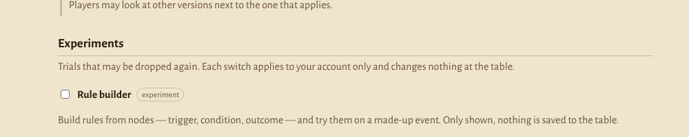
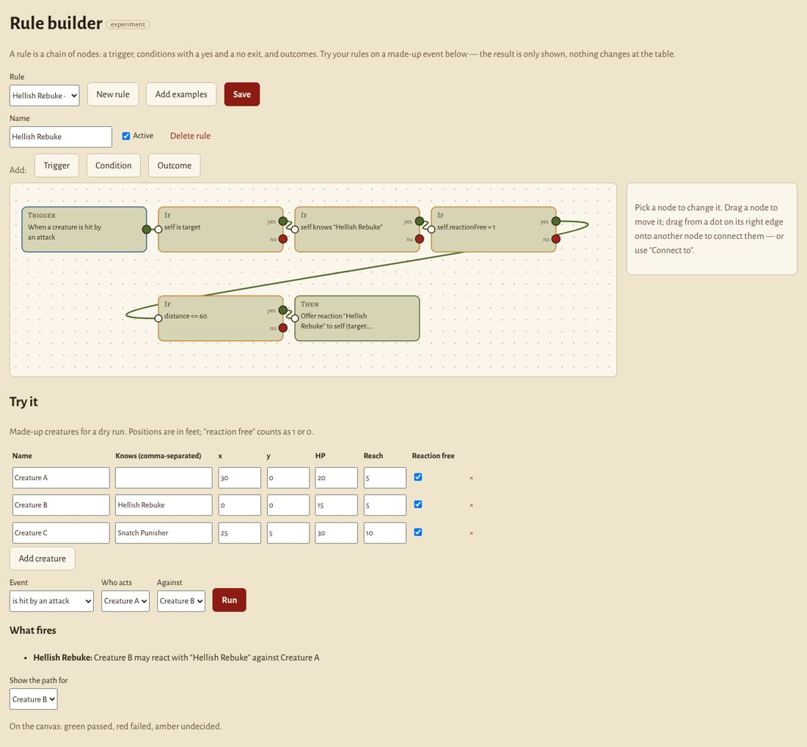
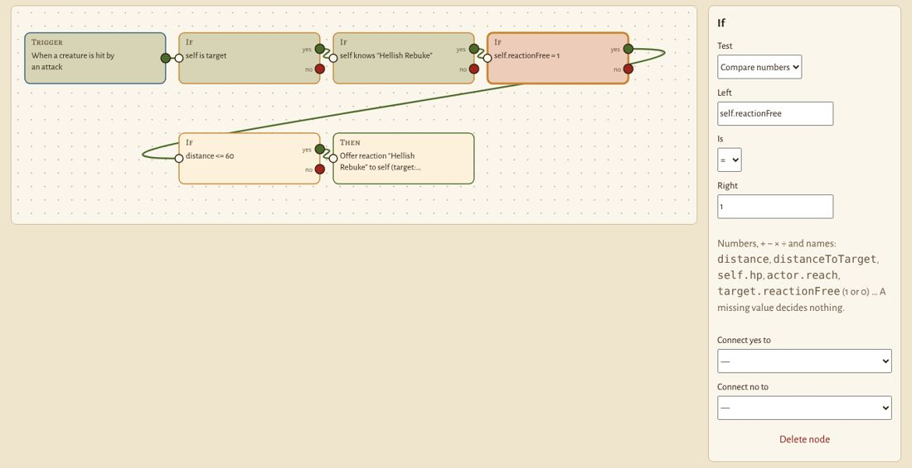
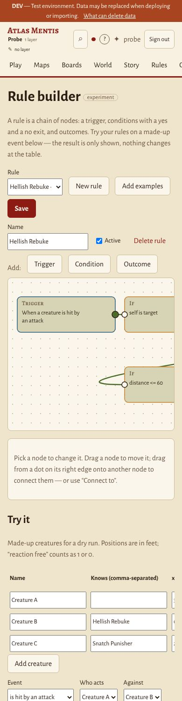
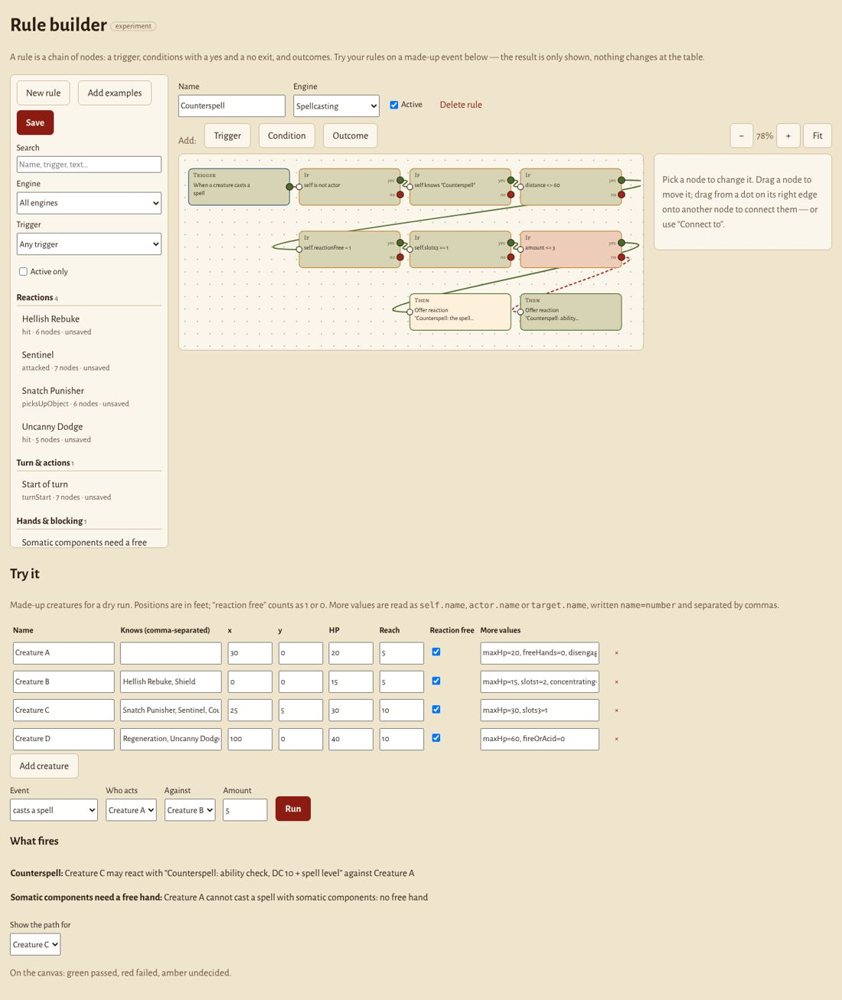
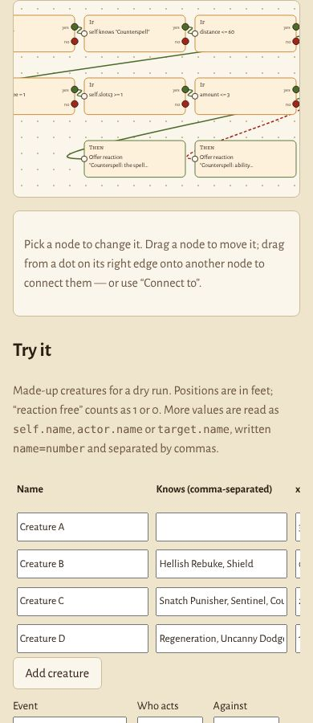

# Regel-Builder mit Knoten — Bericht zum Versuch (T-270)

Stand 18.10.2026. Gehört zu **E-102 (a)** „Regeln als Daten“ und **T-265**
„Rechenwerke als Low-Code“. Die Leitung wünschte einen Versuch wie n8n oder
Node-RED — *Angriff auf Kreatur → Reaktion Hellish Rebuke* —, ohne dass der
jetzige Stand kaputtgeht.

## Was steht

Auf dev unter **`/lab/rules`**, sichtbar erst mit dem Schalter in
**Rules & options › Experiments** (Kampagnenseite, Reiter Rules; nur Leitung
und Verwaltung sehen den Abschnitt). Der Schalter gilt je Konto.

- **Leinwand** (eigenes SVG, keine Bibliothek): Knoten ziehen, aus dem Punkt
  rechts an einem Knoten auf einen anderen ziehen verbindet — oder über
  „Connect to“ im Prüfer (auch am Telefon). Verbindungen anklicken und löschen.
- **Drei Knotenarten**
  - *Trigger*: is attacked, is hit, is missed, takes damage, picks up an
    object, leaves/enters reach, casts a spell, starts/ends its turn.
  - *Condition* mit Ausgang **yes** und **no**: Zahlen vergleichen
    (`distance <= 60`, `self.reactionFree = 1`, `distance <= self.reach`),
    „kennt beim Namen“, „ist dieselbe Kreatur“.
  - *Outcome*: Reaktion anbieten (an wen, gegen wen), Effekt anwenden,
    Aktion sperren mit Grund, Wert ändern.
- **Beide Beispiele fertig gebaut** („Add examples“): Hellish Rebuke
  (getroffen, ich bin das Ziel, kenne den Zauber, Reaktion frei, Angreifer
  ≤ 60 ft → Reaktion gegen den Angreifer) und Snatch Punisher (jemand anderes
  hebt in meiner Reichweite etwas auf, Reaktion frei → Nahkampfangriff).
- **Probelauf** („Try it“): erfundene Kreaturen mit Stellung, HP, Reichweite,
  freier Reaktion und „kennt“; Ereignis wählen, wer handelt, gegen wen →
  *What fires* und der Weg durch die Regel auf der Leinwand (grün bestanden,
  rot nicht, gelb nicht zu entscheiden). **Nur Anzeige** — nichts wird am
  Tisch gespeichert, keine Initiative geändert.

## Nachtrag 18.10. abends: Engines, Filter, mehr Regeln, Telefon

Auf Wunsch der Leitung nach dem ersten Blick auf dev:

- **Übersicht nach Engine** (links, auf dem Telefon oben): Reactions,
  Turn & actions, Hands & blocking, Hit points & damage, Spellcasting,
  Movement & reach, Other — mit Suche (Name und Knotentext) und Filtern nach
  Engine, Auslöser und „Active only“. Die Engine steht an der Regel
  (`RuleGraph.engine`) und lässt sich im Kopf der Regel ändern.
- **Zwölf Beispielregeln** mit 5–9 Knoten und Ja-/Nein-Zweigen: Hellish
  Rebuke, Snatch Punisher, Sentinel, Uncanny Dodge (Reactions), Shield,
  Counterspell (Spellcasting; der Zaubergrad wählt den Zweig), Concentration
  check, Dropping to 0 hit points, Regeneration (Hit points), Somatic
  components need a free hand (Hands), Start of turn (Turn), Opportunity
  attack (Movement). Neue Beispiele kommen in bestehende Konten dazu; wer eins
  löscht, bekommt es nur über „Add examples“ zurück (`labRulesDropped`).
- **Probelauf**: `amount` für Schaden oder Zaubergrad, „More values“ je
  Kreatur (`maxHp=20, slots1=2`), vier Beispielkreaturen; ein Treffer in
  „What fires“ öffnet seine Regel mit dem Weg.
- **Telefon**: Chrome beachtet `touch-action` an SVG-Kindern nicht, darum
  nahm die Leinwand jede Geste und liess sich nicht schieben. Jetzt
  verschiebt Ziehen auf freiem Grund die Fläche selbst (senkrecht Übriges
  scrollt die Seite), Ziehen auf einem Knoten zieht ihn. Zoom −/+ und „Fit“;
  beim Wählen einer Regel wird bis 60 % eingepasst. Geprüft mit echten
  Touch-Ereignissen (CDP) bei 390 px.

## Nachtrag 18.10. spät: Regeln sind Artikel

Auf Wunsch der Leitung kommen Rules & options und der Regel-Builder jetzt
aus **Regelartikeln**: jeder Artikel steht für ein System, eine Regel oder
eine Option (`Rule.kind`, `Rule.key`, `partOf`), der Graph steht am Artikel
(`Rule.graph`, Migration 098). Die Einstellungen im Konto (`labRule.*`)
liest der Builder nicht mehr. Angelegt hat die Artikel
`scripts/regeln-anlegen.mjs`: Hausregeln in der Hausregel-Ebene, was auf
einem Buch beruht oder nur die App betrifft in einer eigenen Ebene „Table
rules“ — nie in einer Buchebene. Regel: [Datenmodell › 10.1](../Datenmodell.md#101-die-regeloptionen-einer-kampagne-t-190).

## Wie es gebaut ist

| Teil | Wo | Bemerkung |
|---|---|---|
| Laufzeit | `packages/model/src/ruleGraph.ts` | `runRules(regeln, ereignis, kreaturen)`; je Kreatur der Szene einmal als `self` gerechnet. Kein `eval`: Namen werden durch Zahlen ersetzt, dann `evalArith`. Ein fehlender Wert gibt „nicht zu entscheiden“ und geht **keinen** Weg (keine irreführende 0). Kreise sind begrenzt. |
| Tests | `packages/model/test/ruleGraph.test.ts` | Beispiele, fehlende Werte, Nein-Ausgang, Kreis, Code im Ausdruck. |
| Seite | `apps/web/src/app/lab/regel-builder.ts`, Route `lab/rules` | |
| Schalter | `apps/web/src/app/lab/experimente-schalter.ts`, `kern/experimente.ts` | nachgeladen (`@defer`) im Reiter Rules |
| Speicher | Einstellungen des Kontos, `/api/me/prefs` | `experiments.ruleBuilder`, je Graph `labRule.<id>` (max. 8000 Zeichen) |

**Nicht berührt:** keine Migration, keine Serverroute, keine Registerzeile,
kein bestehendes Rechenwerk. Ohne Schalter sind Startseite, eine Kreatur und
Play (Initiative) pixelgleich mit vorher (Playwright, 1360 und 390 px); der
Leitung erscheint nur der Abschnitt „Experiments“ am Ende von Rules & options.
Neue Abhängigkeiten: keine. Das erste Bündel wird um etwa 8 kB grösser
(Hilfetext und die Laufzeit im gemeinsamen Modell-Chunk).

**Verwerfen:** Revert des Merge-Commits. Liegen bleiben nur Einstellungen
an den Konten, die niemand mehr liest.

## Was fehlt für den echten Einsatz

1. **Ereignisse aus dem Spiel** statt erfundener: Initiative, Zugplan (T-198),
   Karte und Angriffe müssten Ereignisse ausgeben (E-093) — heute rufen sie
   ihre Rechnungen direkt auf. Das ist der grösste Teil.
2. **Fakten aus den Artikeln**: „kennt Hellish Rebuke“ aus den Zaubern am
   Statblock, Reaktion frei aus `Vitals`/Zugplan, Abstand von der Karte,
   Reichweite aus den Waffen. Heute tippt man sie im Probelauf ein.
3. **Speicherort**: Regeln gehören als Registerzeilen oder Artikel in eine
   Ebene (damit Hausregeln mit dem Regelwerk wandern und Spielende sie lesen),
   nicht ans Konto. Dafür braucht es eine Migration und eine Prüfung in
   `validateEntity`.
4. **Folgen wirklich ausführen**: Reaktion im Zugplan anbieten, Effekte über
   `effects` (E-025), Sperren über die Hände (T-244) — mit Bestätigen durch
   die Leitung.
5. **Mehr Ausdruck**: „und/oder“ ohne Knotenkette, Listen (eine von
   mehreren Bedingungen), Würfe (`{{1d20+5}}`), Werte aus der Kante.
6. **Testfälle in der Zeile** (E-102): je Regel gespeicherte Probeläufe mit
   erwartetem Ergebnis, die die Werkbank prüft.
7. **Editor**: Zoom, Rückgängig, Mehrfachauswahl, Tastatur für alles.

## Aufwand (grob)

| Schritt | Aufwand |
|---|---|
| Regeln als Artikel/Zeilen in einer Ebene, Migration, Validierung | 1–2 Tage |
| Fakten aus Statblock, Vitals, Karte lesen | 2–3 Tage |
| Ereignisse aus Zugplan und Initiative, Reaktion anbieten mit Bestätigen | 3–5 Tage |
| Folgen Effekt/Sperre/Wert an die bestehenden Rechenwerke | 3–5 Tage je Rechenwerk |
| Testfälle in der Zeile, Werkbank-Prüfung | 1 Tag |

Empfehlung: E-102 (a) weiterverfolgen, mit **Reaktionen anbieten** als erstem
echtem Fall (am Zugplan, nur Angebot, die Leitung bestätigt) — der ist eng,
sichtbar und berührt keine Rechnung, die schon stimmt.
