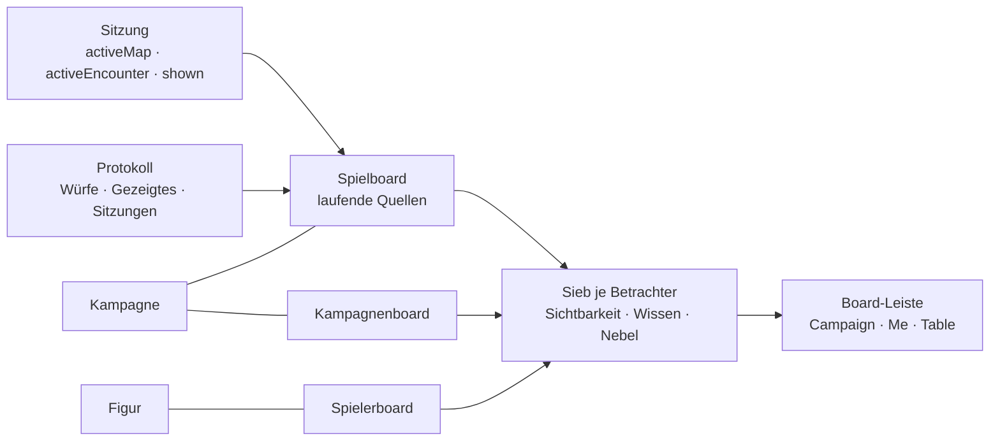

# Der Spieltisch als drei Boards

Stand 2026-10-22. **Vorschlag, nicht gebaut.** Wunsch der Leitung vom
selben Tag:

- Wer am Tisch sitzt, bewegt sich auf **Boards**: dem Kampagnenboard,
  einem Spielerboard und dem Spielboard.
- Zwischen ihnen wechselt man mit einem Tipp.
- Der Rest der Seite (Kompendium, Bereiche, Register, Werkbank) ist für
  Orchestrierung, Inhalt und Vorbereitung da.

Stories: [REQ-362](../../VTT/Stories/REQ-362.md) Spielboard, [REQ-363](../../VTT/Stories/REQ-363.md) Zeigen, [REQ-364](../../VTT/Stories/REQ-364.md) Boards
wechseln, [REQ-119](../../VTT/Stories/REQ-119.md) Spielerboard (erweitert).

---

## Warum

Am 22.10. öffnete eine Spielerin die **Vorlage** einer Karte über die
Liste. Die Vorlage war für die Kampagne sichtbar, aber ohne Nebel. Sie
sah deshalb das ganze Bild und alle Türen, während die Karte im Spiel
noch gar nicht freigegeben war.

Das ist richtig nach dem heutigen Modell und trotzdem falsch am Tisch.
Spielende landen über Listen bei Vorbereitungsstand, weil es keinen Ort
gibt, der sagt, **was jetzt gilt**. Das Spielboard ist dieser Ort.

## Die drei Boards

| Board | gehört | angelegt | befüllt | zeigt |
|---|---|---|---|---|
| **Kampagnenboard** | der Kampagne | mit der Kampagne (steht schon, REQ-358) | erst die Leitung, dann der ganze Tisch | Titel, Gruppe, Aufträge, Gerüchte, alles, was die Runde gemeinsam ablegt |
| **Spielerboard** | einer Figur in einer Kampagne | mit der Figur, wenn ein Konto sie bekommt | die Spielerin selbst | Figur, Inventar, NSC, Geschichte, Notizen: was *sie* braucht |
| **Spielboard** | der Kampagne | einmal, wie das Kampagnenboard | **niemand von Hand**, es rechnet sich | was gerade läuft: Gezeigtes, Karte im Spiel, Kampf, Protokoll |

Alle drei sind **gewöhnliche Boards** (`Board`, `placed`-Kanten,
Abfrage-Kacheln). Es gibt keine dritte Sorte Seite, nur drei Boards mit
einer Bindung:

- Das **Spielerboard** hängt mit `partOf` an der Figur, wie ein Board an
  einem Geschichtsartikel (REQ-205). Sichtbar ist es für die Figur, also
  `revealedTo` die Figur und `audience: gm`. Das Konto steht nie im
  Artikel; die Figur schon (Zugang.md).
- Das **Spielboard** hängt mit `partOf` an der Kampagne und trägt die
  Marke `play`. Seine Kacheln sind **laufende Quellen** (`query.current`,
  wie heute `scene`, `party`, `quests`); neu dazu kommen `shown`, `map`,
  `encounter` und `log`. Gespeichert wird nur das Wort, beantwortet beim
  Lesen (D8).

## Das Spielboard im Einzelnen

Der Schirm, auf den man während der Sitzung schaut:

| Kachel | Quelle | Was sie zeigt |
|---|---|---|
| **Shown** | `Session.shown` | was die Leitung gerade zeigt: Karte, Bild, Artikel, Szene ([REQ-363](../../VTT/Stories/REQ-363.md)) |
| **Map** | `Session.activeMap` | die **Karte im Spiel**, nur wenn freigegeben; nie die Vorlage |
| **Combat** | `Session.activeEncounter` | Initiative, wenn ein Kampf läuft |
| **Scene** | `scene` (gibt es) | Szene und Arc |
| **Log** | Protokoll (REQ-120) | was gezeigt, gewürfelt und aufgedeckt wurde; Sitzungen, die stattfanden |
| **Search** | Widget | die Suche (Strg+K) als Kachel, um nachzulesen |

**Spielende sehen Karten am Tisch nur noch so**, also nicht mehr über
eine Kartenvorlage in der Liste. Der Weg *Maps* in der Basis-Leiste führt
zu den freigegebenen Karten im Spiel. Eine Vorlage bleibt
Vorbereitungsstand und steht für Spielende nur da, wenn die Leitung sie
ausdrücklich teilt. Dann gilt ihr Nebel wie an einer Karte im Spiel (zu
entscheiden: E-1, unten).

Die Anordnung der Kacheln gibt die Vorlage vor (`newPlayBoard`); die
Leitung darf sie umstellen. Eine Kachel ohne Inhalt (kein Kampf) steht
nicht da, nach der Regel „Was nicht gilt, steht nicht da“.

## Zeigen und Ansicht erzwingen ([REQ-363](../../VTT/Stories/REQ-363.md))

- **Show to players** an Karte, Bild, Artikel und Szene setzt
  `Session.shown`: was, wem (alle, oder Figuren) und seit wann.
- Der Live-Kanal sagt es jedem Betroffenen. Das Spielboard springt nach
  vorn, und die Kachel *Shown* geht gross auf (Vollbild auf dem Telefon).
  Mit *Back* geht es dorthin zurück, wo man war.
- **Erzwingen** heisst: Wer gerade auf einem anderen Board oder einer
  Seite ist, wird hingeführt. Wer tippt, wird nicht unterbrochen; dann
  erscheint eine Leiste „The GM is showing … · Open“.
- Gesiebt wird wie überall am Server. Wer einen Artikel nicht sieht,
  bekommt ihn auch gezeigt nicht. Die Leitung wird vorher gewarnt: „Hidden
  from 2 of 4: reveal first?“, mit einem Klick auf *Reveal*.
- Jedes Zeigen kommt ins **Protokoll**. „Was wurde uns gezeigt“ ist
  später eine Frage an das Protokoll (REQ-346).

## Boards wechseln ([REQ-364](../../VTT/Stories/REQ-364.md))

- Die **Basis-Leiste** wird zur **Board-Leiste**: *Campaign · Me · Table*
  vorn, danach Suche und Wissen wie heute.
- Wechseln ist **ein Tipp**, auf dem Telefon auch ein Wischen über den
  Rand; Kürzel `Alt+1`/`2`/`3`. Ziffern allein gehören der Leiste aus
  [Leiste-und-Tasten.md](Leiste-und-Tasten.md).
- Der Blick auf jedes Board bleibt beim Wechseln stehen (Zoom, Lage), wie
  ein Reiter.
- Wer mehrere Figuren führt, hat ein *Me* je Figur. Die Leiste zeigt die
  Figuren als kleine Bilder.
- Die Leitung hat dieselbe Leiste und dazu ihre eigenen Boards
  (Vorbereitung, Geschichtsartikel).

## Wie die Sicht einer Figur gilt

- Ein Konto führt eine oder mehrere Figuren (`app_user_actor`, gibt es),
  also **sieht es, was seine Figuren sehen**:
  - Nebel je Figur (T-204);
  - laufende Sicht der Tokens (T-216);
  - Wissen der Figuren und ihrer Gruppe.
  Das gilt auf allen drei Boards.
- **Koordinator** (zu entscheiden: E-2): ein Konto, das am Tisch mehrere
  oder alle Spielerfiguren steuert, ohne Leitung zu sein. Vorschlag: keine
  neue Rolle, sondern **mehrere Figuren am Konto**, und auf der Karte
  steuert man die Tokens der eigenen Figuren. Eine neue Rolle hiesse eine
  fünfte Stufe in `TableRole` und jede Siebung einmal mehr.

## Was bleibt, wie es ist

- Kompendium, Bereiche, Register, Werkbank: Orchestrierung, Inhalt,
  Vorbereitung. Spielende erreichen sie weiter über die Kopfleiste, landen
  aber auf den Boards (`Campaign.playerStart`, gibt es).
- Die Karte als Element (`map`) bleibt dieselbe. Die Kachel *Map* zeichnet
  sie, wie heute Play › Map.
- Die drei Boards sind keine Sonderseiten. Wer ein Board bearbeiten kann,
  bearbeitet es wie jedes andere.

## Reihenfolge, falls es gebaut wird

1. **Board-Leiste und Spielerboard** ([REQ-364](../../VTT/Stories/REQ-364.md), [REQ-119](../../VTT/Stories/REQ-119.md)): die
   Leiste umbauen und das Board je Figur anlegen. Klein und sofort
   spürbar.
2. **Spielboard mit Map, Combat, Scene, Search** ([REQ-362](../../VTT/Stories/REQ-362.md)): neue
   laufende Quellen, ohne `shown`. Danach führt *Maps* für Spielende nur
   noch zu Karten im Spiel.
3. **Zeigen** ([REQ-363](../../VTT/Stories/REQ-363.md)): `Session.shown`, Live, Erzwingen, Warnung
   und Protokoll.
4. **Log-Kachel** aus dem Protokoll (REQ-120 zu Ende).

## Offen

- **E-1:** Sehen Spielende Kartenvorlagen überhaupt, oder nur Karten im
  Spiel? Vorschlag: nur im Spiel, ausser ausdrücklich geteilt, und dann mit
  Nebel.
- **E-2:** Koordinator als Rolle oder als mehrere Figuren am Konto?
  Vorschlag: mehrere Figuren.
- **E-3:** Erzwingen ohne Rückfrage oder als Hinweis? Vorschlag:
  erzwingen, ausser beim Tippen; *Back* führt zurück.
