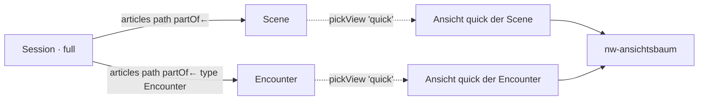

# Verknüpfte Artikel in Ansichten und Werkzeugleiste im Designer (T-425)

Konzept vom 25.10.2026 für REQ-430 und REQ-431. Stand: **wartet auf Basil**
(E-139, E-142 und die Reihenfolge der Schnitte).

## Bestand (preprod 68e9f601, dev)

**Der Designer** (`apps/web/src/app/ansichten/designer.*`, T-268/T-276/T-318)
hat einen Kopf (Ansicht, Gruppe, Geltung), eine Vorschau an einem echten
Artikel, eine Palette nach Sorte, den Baum der Elemente (↑ ↓ → ←, Ziehen) und
rechts die Einstellungen des gewählten Elements. Gespeichert wird eine
`ViewDef` mit `layout`, `group` und `applies`. Auf dev gibt es eine einzige
gestaltete Ansicht: `shop`.

**Die Elemente** (`LayoutElementKind`, `palette.ts`): 44 Stück in vier
Sorten. Davon sind 5 Behälter (Section, Columns, Tabs, Carousel, Collapsible)
und 9 Werte (Heading, Text, Description, Field list, Tile group, Quote,
Badges, Long text, Image). Dazu kommen Table from edges, Table, Structure und
die grossen Blöcke (Statblock, Sheet, Spells …). Jedes Werte-Element nimmt
einen **Pfad** (`path: ViewPathStep[]`, Kante, Richtung, Zielart). Damit
zeigt es Felder an den Artikeln am Ende des Pfads.

**Table from edges** (`edgeTable`) folgt dem Pfad. Es zeichnet je Ziel eine
Zeile: den Namen als Verweis, die Eigenschaften der letzten Kante (`props`)
und die Felder aus `fields`. Die Ziele lädt `Bestand.holen` vom Server, also
schon gesiebt. Eingehende Kanten liest es aus den Rückbezügen.

**Contains** (T-422) ist `looseParts` im Modell plus das Feld `contains` an
`GET /api/entities/:id/parts`. Gemeint ist, was über `partOf` ohne Rang an
einer Story-Art hängt. `nw-fluss` zeichnet es als feste Liste unter dem
Lesefluss: Name, Art, Begegnungsart. Die Liste ist **nicht einstellbar**:
Arten, Sortierung und Darstellung stehen im Code. Auf dev zeigt „Session 1“
damit „Der Alte“ und „Die Miene“ (beides Scenes).

**Leisten**:
- `nw-werkzeugleiste` (REQ-345, T-247) schwebt unten, solange etwas gewählt
  ist: Titel, Aktionen, Undo, Done. Am Telefon zeigt sie nur Zeichen, mit
  einem Blatt von unten (`nw-unterblatt`, T-283). Heute nutzt sie nur „Your
  turn“.
- Die Board-Leiste (T-339, `boards/werkzeuge.scss`) bietet Text, Bild,
  Zeichnen, Karte und Hintergrund.
- Im Designer gibt es **keine** Leiste, nur Palette und Konfiguration als
  Spalten.

**Was fehlt:**
- Ein verknüpfter Artikel kann nicht **in einer Ansicht** erscheinen. Heute
  gibt es nur Felder, Zeilen oder einen Namen.
- Es gibt keinen Filter, keine Sortierung und keine Gruppierung auf dem
  Pfad.
- Es gibt keine Design-Werte (Hintergrund, Ton, Rahmen).

## 1. Element „Linked articles“ (`articles`)

Ein neues Werte-Element. Es nimmt Table from edges und Contains in sich auf.
**Die Views werden wiederverwendet:** jeder Treffer wird mit
`nw-ansichtsbaum` in der gewählten Gruppe seiner eigenen Art gezeichnet,
über dieselbe Wahl wie überall (`pickView` / `viewsFor`).

```ts
{ id, el: 'articles', text?: 'Scenes',
  path: [{ relation: 'partOf', dir: 'in', type: 'Scene' }],   // wie heute
  where?: LayoutWhen[],          // Filter am Ziel (Feld, Kante, wie REQ-415)
  sort?: { by: 'Time.sort' | 'rank' | 'name' | '<Typ.feld>', desc?: boolean },
  groupBy?: 'type' | '<Typ.feld>',
  show: 'list' | 'tiles' | 'table' | 'tree' | 'graph',
  view?: 'overview' | 'quick' | '<eigene Gruppe>',   // je Treffer
  props?: string[],              // Kanteneigenschaften als Spalten/Marken
  limit?: number }
```

| `show` | zeichnet je Treffer | Ansicht |
|---|---|---|
| list | Zeile: Name + Ansicht `overview` | overview (vorgegeben) |
| tiles | Kachel mit Ansicht `quick` (wie Board-Kachel) | quick (vorgegeben) |
| table | Spalten = `overview`-Spalten der Art (T-343) + `props` | – |
| tree | `partOf`-Baum, Knoten in `overview` | overview |
| graph | Struktur (T-341) gebunden an diese Kanten | – |

Regeln, die mitkommen:
- **Gesiebt am Server.** Die Treffer kommen über `Bestand.holen` bzw. die
  Rückbezüge, beide schon zurückgehalten. Eine zweite Prüfung in der Maske
  gibt es nicht (CLAUDE.md).
- **Eine Tiefe.** Ein Treffer, dessen Ansicht selbst `articles` enthält,
  zeichnet dort nur die Namen. Sonst zeichnet eine Session ihre Szenen, die
  Szenen ihre Begegnungen und die Begegnungen ihre Kreaturen.
- **Kein Treffer, kein Kasten.** Leere Plätze erwarteter Kanten (REQ-426)
  kommen erst mit Schnitt 5.
- `edgeTable` bleibt lesbar, als `articles` mit `show: 'table'`. Gespeicherte
  Zeilen werden nicht umgeschrieben, dabei geht nichts verloren. Die Palette
  bietet nur noch „Linked articles“.
- Die feste Liste „Contains“ in `nw-fluss` weicht dem Element, sobald Arc,
  Scene und Session ihre Vorgabe tragen (Schnitt 2). Bis dahin zeigt sie die
  Session nicht doppelt.

## 2. Werkzeugleiste im Designer

```
┌ View: Session · full ──────────────────────────────────── Undo  Save ┐
│ ≡ Fields  ⛓ Links  ¶ Text  ▣ Image  ▥ Layout  ◐ Design  ⊞ Table  ⌥ Graph │
└───────────────────────────────────────────────────────────────────────┘
  [ Preview am echten Artikel ……………………………………………… ]   [ Baum ]
       ┌──────── schwebend, wenn ein Element gewählt ist ────────┐
       │ Linked articles · Scenes  ↑ ↓ ← →  ⧉  🗑   Undo  Done │
       └──────────────────────────────────────────────────────────┘
```

- **Oben die Leiste zum Einfügen** in acht Gruppen. Jede Gruppe ist ein
  Aufklapper mit den Palette-Einträgen ihrer Sorte und dem häufigsten
  Schalter:
  - Fields: Field list, Tile group, Badges, Quote
  - Links: Linked articles mit Kante und Darstellung
  - Text: Heading, Text (Markdown, REQ-424), Long text
  - Image: Bild des Artikels, eines Ziels oder ein Upload
  - Layout: Section, Columns, Tabs, Carousel, Collapsible
  - Design: Hintergrund, Ton, Rahmen, Abstand
  - Table: Table, Linked articles als Tabelle
  - Graph: Structure, Linked articles als Graph

  Die Palette als Spalte fällt weg. Ihre Suche wandert in die Leiste („Find
  an element…“).
- **Unten schwebend** `nw-werkzeugleiste` für das gewählte Element: ordnen,
  verdoppeln, löschen, Undo, Done. Am Telefon steht die Konfiguration als
  Blatt von unten (`nw-unterblatt`).
- **Undo** im Entwurf, als Stapel von Layout-Ständen. Gespeichert wird erst
  mit Save, wie heute.
- **Design sind Tokens**, keine Farbcodes. Am Element steht
  `style?: { bg?: 'paper' | 'surface' | 'accent-soft' | 'field:<Typ.feld>', tone?: 'muted' | 'accent', frame?: 'none' | 'line' | 'card', pad?: 0-3 }`.
  Das sind Werte aus den Tokens von `styles.scss`, hell und dunkel geprüft;
  `field:` liest eine Farbe wie T-240.

## 3. Wiederverwendung



Eine Ansicht `quick` der Szene, die die Leitung im Designer ändert, ändert
damit auch die Kacheln auf der Session. Dasselbe gilt für das Board und das
Popup. Eine Sonderseite gibt es nicht.

## 4. Schnitte

1. **Session zeigt Szenen und Begegnungen über eine Ansicht.**
   - Modell: `articles` mit `show` list/tiles, `view` und `sort`, dazu
     `linkedHits()` mit Sortierung.
   - Baum: zeichnet Treffer rekursiv in ihrer Ansicht, mit einer Tiefe.
   - Palette: Eintrag „Linked articles“.
   - Session full: Vorgabe „Scenes and encounters“ als Kacheln in `quick`,
     dazu eine Migration wie 142.
   - Test zuerst rot (Modell, Baum, E2E auf Session 1).
2. **Filter, Gruppierung, Tabelle.**
   - `where`, `groupBy`, `show: table` (Spalten aus `overview`).
   - `edgeTable` als Alias.
   - Vorgaben für Arc, Scene, Encounter, Place und Faction.
   - „Contains“ in `nw-fluss` fällt weg.
3. **Werkzeugleiste im Designer.**
   - Einfügen in Gruppen, schwebende Leiste fürs Gewählte, Undo.
   - Am Telefon als Blatt.
4. **Design-Tokens** (`style`): Hintergrund, Ton, Rahmen und Abstand, auch
   aus Feldwerten.
5. **Baum und Graph** als Darstellung, dazu leere Plätze erwarteter Kanten
   (REQ-426).
6. **Dieselbe Leiste für Board-Kacheln und Seiten**, sobald E-139 entschieden
   ist.

## Entscheide

**E-139 (ein Muster für Ansichten, Kacheln, Seiten):** Empfehlung **a**, in
Raten.
- Mit T-425 werden das Element und die Leiste so gebaut, dass sie nichts von
  „Artikelseite“ wissen. Die Leiste ist `nw-werkzeugleiste` plus ein
  Einfüge-Kopf, und jedes Element zeichnet `nw-ansichtsbaum`.
- Die Board-Kachel zeichnet schon heute eine gestaltete Ansicht. Schnitt 6
  braucht darum keinen Umbau der Kacheln, nur die Leiste dort.

**E-142 (Tabellen als Ansicht oder Widget):** Empfehlung **a**, in Raten.
- Zuerst ist „Linked articles“ das Widget, das eine Sammlung zeigt. Wie die
  Sammlung aussieht (`show`, Spalten, Gruppierung), steht am Element.
- Sobald ein zweiter Ort dieselbe Sammlungsansicht braucht (Kompendium,
  Board), wird sie zu einer `ViewDef` mit Art „collection“, und das Element
  nennt sie (`collection: '<key>'`).
- Vorher wäre die Sammlungsansicht eine Zeile ohne zweiten Nutzer (CLAUDE.md:
  eine Liste mit genau einem Nutzer bleibt am Feld).
