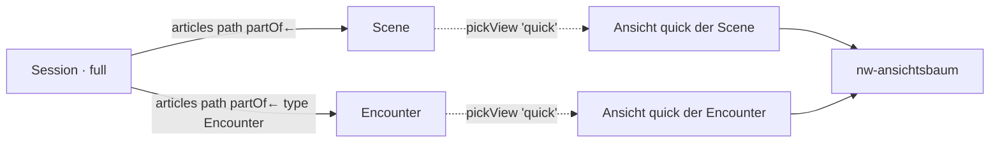

# Verknüpfte Artikel in Ansichten und Werkzeugleiste im Designer (T-425)

Konzept vom 25.10.2026 für REQ-430 und REQ-431, erweitert am 26.10. um
REQ-432 bis REQ-437. Stand: **Entscheide gefallen (26.10., zuletzt E-173 bis E-176)**, wartet auf
Basils Freigabe der Übersicht unten.

Zwei Vorschläge vom 25.10. haben die Entscheide geändert:
- Aus dem Element `articles` wurde `collection` (E-142).
- Die Ansicht wählt immer das Element (E-172).

## Bestand (preprod 68e9f601, dev)

**Der Designer** (`apps/web/src/app/ansichten/designer.*`, T-268/T-276/T-318)
hat einen Kopf (Ansicht, Gruppe, Geltung), eine Vorschau an einem echten
Artikel, eine Palette nach Sorte, den Baum der Elemente (↑ ↓ → ←, Ziehen) und
rechts die Einstellungen des gewählten Elements. Gespeichert wird eine
`ViewDef` mit `layout`, `group` und `applies`. Auf dev gibt es eine einzige
gestaltete Ansicht: `shop`.

**Die Elemente** (`LayoutElementKind`, `palette.ts`): 44 Stück in vier
Sorten. Davon sind 5 Behälter (Section, Columns, Tabs, Carousel, Collapsible)
und 9 Werte (Heading, Text, Description, Field list, Tile group, Quote,
Badges, Long text, Image). Dazu kommen Table from edges, Table, Structure und
die grossen Blöcke (Statblock, Sheet, Spells …). Jedes Werte-Element nimmt
einen **Pfad** (`path: ViewPathStep[]`, Kante, Richtung, Zielart). Damit
zeigt es Felder an den Artikeln am Ende des Pfads.

**Table from edges** (`edgeTable`) folgt dem Pfad. Es zeichnet je Ziel eine
Zeile: den Namen als Verweis, die Eigenschaften der letzten Kante (`props`)
und die Felder aus `fields`. Die Ziele lädt `Bestand.holen` vom Server, also
schon gesiebt. Eingehende Kanten liest es aus den Rückbezügen.

**Contains** (T-422) ist `looseParts` im Modell plus das Feld `contains` an
`GET /api/entities/:id/parts`. Gemeint ist, was über `partOf` ohne Rang an
einer Story-Art hängt. `nw-fluss` zeichnet es als feste Liste unter dem
Lesefluss: Name, Art, Begegnungsart. Die Liste ist **nicht einstellbar**:
Arten, Sortierung und Darstellung stehen im Code. Auf dev zeigt „Session 1“
damit „Der Alte“ und „Die Miene“ (beides Scenes).

**Leisten**:
- `nw-werkzeugleiste` (REQ-345, T-247) schwebt unten, solange etwas gewählt
  ist: Titel, Aktionen, Undo, Done. Am Telefon zeigt sie nur Zeichen, mit
  einem Blatt von unten (`nw-unterblatt`, T-283). Heute nutzt sie nur „Your
  turn“.
- Die Board-Leiste (T-339, `boards/werkzeuge.scss`) bietet Text, Bild,
  Zeichnen, Karte und Hintergrund.
- Im Designer gibt es **keine** Leiste, nur Palette und Konfiguration als
  Spalten.

**Was fehlt:**
- Ein verknüpfter Artikel kann nicht **in einer Ansicht** erscheinen. Heute
  gibt es nur Felder, Zeilen oder einen Namen.
- Es gibt keinen Filter, keine Sortierung und keine Gruppierung auf dem
  Pfad.
- Es gibt keine Design-Werte (Hintergrund, Ton, Rahmen).

## 1. Element „Linked articles“ (`articles`, seit E-142: `collection`)

Ein neues Werte-Element. Es nimmt Table from edges und Contains in sich auf.
**Die Views werden wiederverwendet:** jeder Treffer wird mit
`nw-ansichtsbaum` in der gewählten Gruppe seiner eigenen Art gezeichnet,
über dieselbe Wahl wie überall (`pickView` / `viewsFor`).

```ts
{ id, el: 'articles', text?: 'Scenes',
  path: [{ relation: 'partOf', dir: 'in', type: 'Scene' }],   // wie heute
  where?: LayoutWhen[],          // Filter am Ziel (Feld, Kante, wie REQ-415)
  sort?: { by: 'Time.sort' | 'rank' | 'name' | '<Typ.feld>', desc?: boolean },
  groupBy?: 'type' | '<Typ.feld>',
  show: 'list' | 'tiles' | 'table' | 'tree' | 'graph',
  view?: 'overview' | 'quick' | '<eigene Gruppe>',   // je Treffer
  props?: string[],              // Kanteneigenschaften als Spalten/Marken
  limit?: number }
```

| `show` | zeichnet je Treffer | Ansicht |
|---|---|---|
| list | Zeile: Name + Ansicht `overview` | overview (vorgegeben) |
| tiles | Kachel mit Ansicht `quick` (wie Board-Kachel) | quick (vorgegeben) |
| table | Spalten = `overview`-Spalten der Art (T-343) + `props` | – |
| tree | `partOf`-Baum, Knoten in `overview` | overview |
| graph | Struktur (T-341) gebunden an diese Kanten | – |

Regeln, die mitkommen:
- **Gesiebt am Server.** Die Treffer kommen über `Bestand.holen` bzw. die
  Rückbezüge, beide schon zurückgehalten. Eine zweite Prüfung in der Maske
  gibt es nicht (CLAUDE.md).
- **Eine Tiefe.** Ein Treffer, dessen Ansicht selbst `articles` enthält,
  zeichnet dort nur die Namen. Sonst zeichnet eine Session ihre Szenen, die
  Szenen ihre Begegnungen und die Begegnungen ihre Kreaturen.
- **Kein Treffer, kein Kasten.** Leere Plätze erwarteter Kanten (REQ-426)
  kommen erst mit Schnitt 5.
- `edgeTable` bleibt lesbar, als `articles` mit `show: 'table'`. Gespeicherte
  Zeilen werden nicht umgeschrieben, dabei geht nichts verloren. Die Palette
  bietet nur noch „Linked articles“.
- Die feste Liste „Contains“ in `nw-fluss` weicht dem Element, sobald Arc,
  Scene und Session ihre Vorgabe tragen (Schnitt 2). Bis dahin zeigt sie die
  Session nicht doppelt.

## 2. Werkzeugleiste im Designer

```
┌ View: Session · full ──────────────────────────────────── Undo  Save ┐
│ ≡ Fields  ⛓ Links  ¶ Text  ▣ Image  ▥ Layout  ◐ Design  ⊞ Table  ⌥ Graph │
└───────────────────────────────────────────────────────────────────────┘
  [ Preview am echten Artikel ……………………………………………… ]   [ Baum ]
       ┌──────── schwebend, wenn ein Element gewählt ist ────────┐
       │ Linked articles · Scenes  ↑ ↓ ← →  ⧉  🗑   Undo  Done │
       └──────────────────────────────────────────────────────────┘
```

- **Oben die Leiste zum Einfügen** in acht Gruppen. Jede Gruppe ist ein
  Aufklapper mit den Palette-Einträgen ihrer Sorte und dem häufigsten
  Schalter:
  - Fields: Field list, Tile group, Badges, Quote
  - Links: Linked articles mit Kante und Darstellung
  - Text: Heading, Text (Markdown, REQ-424), Long text
  - Image: Bild des Artikels, eines Ziels oder ein Upload
  - Layout: Section, Columns, Tabs, Carousel, Collapsible
  - Design: Hintergrund, Ton, Rahmen, Abstand
  - Table: Table, Linked articles als Tabelle
  - Graph: Structure, Linked articles als Graph

  Die Palette als Spalte fällt weg. Ihre Suche wandert in die Leiste („Find
  an element…“).
- **Unten schwebend** `nw-werkzeugleiste` für das gewählte Element: ordnen,
  verdoppeln, löschen, Undo, Done. Am Telefon steht die Konfiguration als
  Blatt von unten (`nw-unterblatt`).
- **Undo** im Entwurf, als Stapel von Layout-Ständen. Gespeichert wird erst
  mit Save, wie heute.
- **Design sind Tokens**, keine Farbcodes. Am Element steht
  `style?: { bg?: 'paper' | 'surface' | 'accent-soft' | 'field:<Typ.feld>', tone?: 'muted' | 'accent', frame?: 'none' | 'line' | 'card', pad?: 0-3 }`.
  Das sind Werte aus den Tokens von `styles.scss`, hell und dunkel geprüft;
  `field:` liest eine Farbe wie T-240.

## 3. Wiederverwendung



Eine Ansicht `quick` der Szene, die die Leitung im Designer ändert, ändert
damit auch die Kacheln auf der Session. Dasselbe gilt für das Board und das
Popup. Eine Sonderseite gibt es nicht.

## 4. Schnitte

1. **Session zeigt Szenen und Begegnungen über eine Ansicht.**
   - Modell: `articles` mit `show` list/tiles, `view` und `sort`, dazu
     `linkedHits()` mit Sortierung.
   - Baum: zeichnet Treffer rekursiv in ihrer Ansicht, mit einer Tiefe.
   - Palette: Eintrag „Linked articles“.
   - Session full: Vorgabe „Scenes and encounters“ als Kacheln in `quick`,
     dazu eine Migration wie 142.
   - Test zuerst rot (Modell, Baum, E2E auf Session 1).
2. **Filter, Gruppierung, Tabelle.**
   - `where`, `groupBy`, `show: table` (Spalten aus `overview`).
   - `edgeTable` als Alias.
   - Vorgaben für Arc, Scene, Encounter, Place und Faction.
   - „Contains“ in `nw-fluss` fällt weg.
3. **Werkzeugleiste im Designer.**
   - Einfügen in Gruppen, schwebende Leiste fürs Gewählte, Undo.
   - Am Telefon als Blatt.
4. **Design-Tokens** (`style`): Hintergrund, Ton, Rahmen und Abstand, auch
   aus Feldwerten.
5. **Baum und Graph** als Darstellung, dazu leere Plätze erwarteter Kanten
   (REQ-426).
6. **Dieselbe Leiste für Board-Kacheln und Seiten**, sobald E-139 entschieden
   ist.

## Entscheide (26.10.2026, mit Basil im Chat)

| Entscheid | Frage | Entschieden |
|---|---|---|
| E-168 | Ansichten auf jeder Ebene zusammenführen | **a, Schichten**: global → Typkette → Bedingungen (Feld, Kante) → Artikel. Jede Schicht fügt hinzu, ändert, verschiebt oder blendet aus. Die Position ist eine Zahl; an derselben Stelle entscheidet die Priorität, dann die genauere Schicht. |
| E-139 | Ein Muster für Ansichten, Kacheln, Seiten | **a, in Raten**: zuerst der Ansichtsdesigner, danach Board, Play und Seiten mit derselben Leiste. |
| E-142 | Sammlungen | **Eigener Entscheid**: ein Element **Collection** mit Quelle *verknüpft* (Kanten) oder *Filter* (sichtbare Artikel wie im Kompendium), Darstellung (Liste, Kacheln, Tabelle, Baum, Graph), Sortierung, Gruppierung und Ansicht je Treffer. Eine eigene Sorte Sammlungsansicht gibt es nicht. Wiederverwendet wird über Kopieren und die Schichten. REQ-376 ist damit `dropped` und wird durch REQ-430 ersetzt. |
| E-172 | Ansicht eines eingebundenen Artikels | **Eigener Entscheid**: Das Element wählt. **Linked article** zeigt ein Ziel; Kante und Ansicht sind wählbar, bei `asField` bleibt es bearbeitbar wie heute. **Collection** zeigt viele, mit einer Vorgabe je Zielart. An der Kante wird nichts gespeichert; die Board-Kachel behält `placed.view`. |
| E-171 | Werkzeugleiste | **a**: eine Leiste (Desktop oben, Telefon unten) mit drei Zonen: Einfügen, Kontext und Allgemein (Auswählen, Kopieren, Einfügen, Duplizieren, Löschen, Rückgängig, Wiederholen, Fertig). Die Einstellungen stehen am Element in der Vorschau. |
| E-170 | Design-Tokens | **a**: Registerzeilen mit Name, Rolle, Wert hell und Wert dunkel; der Kontrast wird geprüft. Jedes Element hat benannte Stellen (Kopf, Fläche, Rahmen, Text). Die Ansicht gibt je Elementart vor, das Element darf überschreiben. Die Auswahl zeigt zuerst die genutzten Tokens. |
| E-169 | Erfassungsmasken | **a**: zwei Ortsansichten, `create` (schnell, Dialog) und `createFull` (ausführlich). Ohne Gestaltung fällt jede auf das Heutige zurück. Die Spielerfigur bekommt in `create` das Element **Character builder**. |
| E-173 | Gleiche Position in zwei Schichten | **a, dazu in der Werkbank**: Die Position ist eine Sortierzahl. Bei Gleichstand ordnet die Priorität, dann die genauere Schicht. Ändern zwei Schichten dasselbe Element, gewinnt die genauere, und die Priorität kann das drehen. Der Designer markiert beides mit ⚠ und den Quellen; die Werkbank-Prüfung „View conflicts“ listet es je Ansicht, mit Sprung in den Designer. |
| E-174 | Gruppierungen des Regelwerks | **Eigener Entscheid**: Artikeltyp **Collection** (unter Rule). Mitglieder kommen nach Regel (Typ, Felder, Kanten) und von Hand über die Kante `inCollection` (Mitglied → Collection); dieselbe Kante mit `props.exclude` nimmt aus. Unterkollektionen hängen über `partOf`. `MaterialGroup` wird ein Untertyp. Party und Fraktion bleiben eigene Arten (Träger von Wissen und Sichtbarkeit, A8) und lassen sich als Quelle des Elements Collection zeigen. |
| E-175 | Laden ohne `buys` | **a**: Er kauft alles zu `Shop.buyRate` (leer 50 %, E-045 b). Mit `buys`-Kanten kauft er nur das Genannte (Gegenstand oder Collection), zu ihrem Satz. `sells` geht auf einen Gegenstand oder eine Collection; eine einzelne Kante schlägt die Collection. |
| E-176 | Geführte Abläufe | **Eigener Entscheid: View mit Steps.** `steps` ist ein Layout-Element der Erfassungsansichten, jedes Kind ist eine Seite. Der Ablauf ergibt sich aus den Regelelementen und der Ansicht. `levelUp` ist eine Ansicht, die per Schicht vom Creator ableitet, und weitere Abläufe sind weitere Ansichten. Ein Fortschritt wird nicht eigens gespeichert: Wo man steht, ergibt sich aus dem, was befüllt ist. **Fehlen Pflichtfelder, darf der Artikel nur mit Status `idea` gespeichert werden.** |
| E-177 | Wo steht „Pflicht für einen Stand“? | **a**: `requiredFor: prepared \| ready` am Feld bzw. an der Kantenart, neben `required` (immer). Je Typ überschreibbar wie `titles`. |
| E-178 | Wann wird geprüft? | **a**: beim Setzen eines Stands und beim Rückfall nach D74 (auf den höchsten erreichbaren Stand). Wer den Stand schon hat, behält ihn, das Speichern warnt. Die Werkbank zeigt „Ready with gaps“. |
| E-179 | Artikel ohne Status-Karte | **b**: Eine Migration setzt `ready` (auf dev für das Dienstkonto sichtbar: 138, meist 5e.tools). Danach ist der Status immer Pflicht. |
| E-180 | Kanten als Pflicht | **a**: Kanten tragen dieselbe Angabe wie Felder; `inLayer` ist immer Pflicht. |
| E-181 | Ebenen und Collections | **Eigener Entscheid**: Ebenenbaum Game system › Edition › Release (Official, Playtest, Third party) › Modul; jede Stufe ist eine Ebene. Herausgeber, Buchart, Setting und Epoche sind Felder am Modul, gruppiert über Collections. Aufschalten als Baum bis zum Artikel (REQ-444, REQ-445, gehört zu T-421). |
| E-182 | Ebene Pflicht: Ausnahmen | **Eigener Entscheid**: Ausgenommen sind nur Ebenen. Eine Ebene „Unassigned“ dient als Parkplatz und Todo; die Migration legt dort ab, was heute keine Ebene hat (dev: 6 Bilder), Kampagnen gehen in ihre Kampagnenebene. |
| E-183 | Kampagne im Ebenenbaum | **a**: Modul wie ein Abenteuer, unter Game system › Edition › Release „Homebrew“ (neuer Wert). Der Kampagnenartikel liegt in seiner eigenen Kampagnenebene. Besitzer und Buchart Campaign sind Felder, „Basils Kampagnen“ ist eine Collection. REQ-414 ist angepasst. |

Neue Stories vom 26.10.:
- REQ-432: Erfassungsmasken
- REQ-433: Charaktererstellung
- REQ-434: Schichten
- REQ-435: Ansicht eingebundener Artikel
- REQ-436: Werkzeugleiste als Muster
- REQ-437: Design-Tokens
- REQ-438: Collections als Artikel
- REQ-439: Laden mit `sells`/`buys` auf Gegenstand oder Collection
- REQ-440: Abläufe als Ansicht mit Steps
- REQ-441: Pflicht je Stand
- REQ-442: 5e.tools nachprüfen (T-427)
- REQ-443: Ein Modul teilt nur Fertiges
- REQ-444: Ebenenbaum
- REQ-445: Aufschalten als Baum (beide zu T-421)

REQ-422 ist angepasst; der Durchgang durch die Erfassungsansichten je Art läuft als T-426.

REQ-430 und REQ-431 sind an die Entscheide angepasst.

## Was sich am Bestand ändert

Gezählt auf dev am 26.10.2026:
- 91 Arten, davon 43 mit eigenen Ansichten: 41 eigene Anordnungen und 43 Anpassungen.
- 6 Ansichten: overview, quick, full, print, handout, shop. Gestaltet ist nur `shop`, eine eigene Gruppe mit Geltung „Kreatur mit eingehendem shopkeeper“.

**Kein Artikel wird umgeschrieben, und es gehen keine Daten verloren.** Felder,
Kanten und Ebenen bleiben, wie sie sind. An Kanten kommt keine neue
Eigenschaft dazu (E-172).

| Was | Heute | Danach | Sichtbar? | Wie |
|---|---|---|---|---|
| **Artikel** (Daten) | – | unverändert | nein | – |
| **Eigene Anordnungen je Art** (41) | ersetzen, was darüber gilt | eine Schicht, die alles setzt | nein, sie zeichnen gleich | Die Positionen werden beim Lesen aus der Reihenfolge gerechnet (10, 20, …) und erst gespeichert, wenn jemand verschiebt. Eine Migration gibt es nicht. |
| **Anpassungen je Art** (43) | `adjust` (drop, hide, add, extra, order) | gleich, dazu wahlweise Position und Bedingung | nein | Die Form wird erweitert, nichts wird umgeschrieben. |
| **Gestaltete Ansicht `shop`** | eigene Gruppe, wählbar auf Kachel und Leiste | unverändert | nein | Eine eigene Gruppe ist keine Schicht von `full`. |
| **„Table from edges“** (2 Stellen: Party › quick „Members“, `shop` „Wares“) | Element `edgeTable` | Collection, Darstellung Tabelle | nein (gleiche Spalten) | Eine Migration schreibt beide Zeilen um (`path` → `source.edges`, `props` → Spalten). Alte Zeilen werden weiter gelesen. Vorher/Nachher-Bild. |
| **Liste „Contains“** (`nw-fluss`; auf dev an 29 Arcs, 1596 Scenes, 2 Sessions, 48 Encounters) | feste Liste unter dem Text: Name, Art, Begegnungsart | ein Collection-Element in `full` von Arc, Scene, Session, Encounter | **ja**: Statt einer festen Zeile steht jeder Treffer in seiner Ansicht | Vorgabe: Session und Arc als Kacheln (quick), Scene als Liste (overview). Migration wie 142, danach fällt die feste Liste weg. |
| **Element `parts`** (Lesefluss mit Rang) | Kapitel, Szene, Session | unverändert | nein | – |
| **Element „Linked article“** (`linked`, 3 Stellen: Statblock an der Kreatur, Gegenstand, `full`) | Felder einer `asField`-Kante, bearbeitbar | gleich, dazu wahlweise jede Kante und eine Ansicht | nein | Die Erweiterung ist optional. |
| **Quick-Ansicht von Map** | Felder, Map.kind | dazu die Karte klein | **ja**: Popup, Marker und Kachel einer Karte zeigen sie | neue Vorgabe in `packages/registry`, Migration |
| **Quick-Ansicht von Board** | keine eigene | die Tafel verkleinert | **ja**: Kachel und Popup eines Boards | wie oben |
| **Quick-Ansicht von Table** | Zeilen (Element `table`) | unverändert | nein | – |
| **Anlegen** („New article“) | Name, Art, Pflichtfelder ohne Vorgabe; Spielerfigur verweist auf den Assistenten | gleich, solange eine Art kein `create` hat | nein | Neu sind zwei Ortsansichten in `PLACE_VIEWS`. `create` der Spielerfigur startet den Assistenten direkt statt über den Verweis. |
| **Farben** | CSS-Variablen in `styles.scss` (hell, dunkel, Druck) | Registerzeilen `tokens`, mit den heutigen Werten vorbelegt | nein, bis jemand eins setzt | neuer Registerteil, Migration, Abgleich |
| **Ansichtsdesigner** | Palette links, Baum, Einstellungen rechts | Leiste oben, Vorschau mit Einstellungen am Element, Baum zum Ordnen | **ja**: Die Arbeitsweise ändert sich (entschieden in E-171) | Handbuch und Hilfe ziehen nach |
| **Board-Leiste, schwebende Leiste der Spielerseite** | eigene Leisten | dieselbe Komponente (REQ-436) | **ja**, später | eigener Schnitt |
| **Pflicht** (`validateEntity`) | Wenige Felder sind immer Pflicht (Name, Nummer, drei Spezialfelder); das Fehlen lehnt ab | immer Pflicht: Name, Nummer, Status, Ebene (ausser an Ebenen); dazu `requiredFor` je Stand, geprüft beim Setzen des Stands | **ja**: Ein Stand lässt sich erst setzen, wenn alles da ist; Ideen bleiben schnell | Bestehende Artikel behalten ihren Stand (E-178). Spielende sehen fremde Ideen nicht (D72). |
| **Artikel ohne Status-Karte** (dev: 138) | gelten als fertig | ausdrücklich `ready` | nein | Migration mit Prüfabfrage (E-179) |
| **Artikel ohne Ebene** (dev: 6 Bilder, 2 Kampagnen) | gehören niemandem | Ebene „Unassigned“; Kampagnen in ihre Kampagnenebene (E-183) | nein, in der Werkbank als Todo | Migration (E-182) |
| **Assistent der Spielerfigur** (`/characters/new`) | eigene Seite, Schritte aus `builderSteps` | Vorgabe der `create`-Ansicht der Spielerfigur mit Element `steps`; `levelUp` leitet davon ab | nein, solange niemand anpasst | Die Seite bleibt erreichbar und leitet in die Ansicht. Ein halber Charakter ist eine Idee (oben). |
| **Laden** (`sells`-Kanten, `Shop`) | `sells` nur auf Gegenstände, Ankauf von allem zur Hälfte | `sells` und neu `buys` auf Gegenstand oder Collection, Waren gerechnet | nein, bis jemand Collections nutzt | Bestehende Kanten bleiben gültig, neue Kantenart `buys`, Feld `Shop.buyRate` (E-045 b). Element `wares` kommt in die Palette. |
| **Ansicht `shop`** (am Ladenhalter) | „Wares“ als Table from edges über die rohen `sells`-Kanten | Element `wares` über den Pfad `shopkeeper ←`, mit gerechneten Preisen | **ja**: Preise mit Abschlägen statt roher Kanteneigenschaften | Migration der Ansichtszeile |
| **`MaterialGroup`** (Handwerk) | eigene Regelart mit Kriterien und Gegenständen | Untertyp von Collection | nein | Felder und Gruppen bleiben, Migration ohne Verlust. Die Ersatzregeln (T-197) lesen weiter dasselbe. |
| **Neu: Artikeltyp Collection, Kante `inCollection`** | – | Gruppierungen des Regelwerks als Artikel | nein, bis welche angelegt sind | Registerzeile und Migration. Der 5e.tools-Import kann die Collections des Grundregelwerks später anlegen, ohne Artikel umzuschreiben. |
| **Regeln in CLAUDE.md** | „Vier Ansichten“, „Die Anordnung wohnt am Typ“, „Der Ort wählt die Gruppe …“ | um Schichten, Collection, Tokens und Erfassung ergänzt | – | im selben Commit wie die Änderung, dazu Datenmodell, Begriffe, „How it works“, Handbuch, Glossar, What's new |

Neue Wörter fürs Glossar und für Begriffe.md:
- Collection
- Schicht
- Token
- Erfassungsmaske (create)
- Steps (Seite eines Ablaufs)
- `inCollection`, `buys`

## Schnitte (neu, 26.10.)

1. **Session zeigt Szenen und Begegnungen über eine Collection.**
   - Quelle verknüpft, Darstellung Liste und Kacheln, Ansicht je Treffer, Sortierung.
   - Vorgabe an der Session (Migration). Die feste Liste „Contains“ fällt dort weg.
   - Test zuerst rot.
2. **Schichten (E-168).**
   - Positionen und Bedingungen in `adjust`, ausgewertet in `forArticle`/`viewsFor`.
   - Der Designer zeigt die Herkunft je Element.
   - Beispiel: „Map an Position 40, wenn onMap“ in der Schicht „alle Artikel“.
   - Gleichstände und Konflikte mit ⚠ im Designer, Prüfung „View conflicts“ in der Werkbank (E-173).
3. **Collection fertig.**
   - Filter-Quelle, Tabelle, Gruppierung.
   - `edgeTable` migrieren.
   - Vorgaben für Arc, Scene, Encounter, Place, Faction.
   - Die feste Liste „Contains“ fällt ganz weg.
4. **Linked article mit Kante und Ansicht**, dazu die Quick-Ansichten von Map und Board.
5. **Werkzeugleiste (REQ-436) im Designer**:
   - Einfügen, Kontext, Allgemein.
   - Einstellungen am Element.
   - Kopieren, Einfügen, Duplizieren, Rückgängig, Wiederholen.
6. **Design-Tokens (REQ-437)**: Registerteil, Stellen je Element, Vorgaben je Ansicht.
7. **Erfassungsmasken (REQ-432)**, dazu „nur `idea`, solange Pflichtfelder fehlen“.
8. **Abläufe (REQ-440, REQ-433)**: Element `steps`, der Assistent als Vorgabe der Spielerfigur, `levelUp` als abgeleitete Ansicht.
9. **Pflicht je Stand (REQ-441)**: `requiredFor`, Status und Ebene immer Pflicht, Migrationen „ready“ und „Unassigned“. Das kann auch früher kommen, weil es von den Schnitten 1 bis 6 unabhängig ist.
10. **Collections als Artikel (REQ-438)** und **Laden mit `sells`/`buys` (REQ-439)**, `MaterialGroup` als Untertyp, `wares` in der Palette.
11. **Dieselbe Leiste an Board, Karte und Spielerseite**, dazu Baum und Graph als Darstellung und die leeren Plätze erwarteter Kanten (REQ-426).

Unabhängig von T-425, aber damit abgestimmt:
- Ebenenbaum und Aufschalten (REQ-444, REQ-445) gehören zu **T-421**.
- Die 5e.tools-Nachprüfung (REQ-442) läuft als **T-427**.
- Die Erfassungsansichten je Art (Durchgang) laufen als **T-426**.
